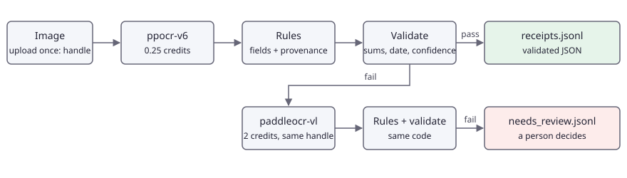

<!-- en-sha: 87b99d1a264d -->
# 收据和发票转为经过校验的 JSON

[English](README.md) | 简体中文

用 `ppocr-v6` 读取收据和发票，按规则抽取商户、日期、明细和合计，校验金额是否对得上，只把校验失败的项用 `paddleocr-vl` 重读。仍然失败的项写入复核文件，不进入数据库。

## 问题 <!-- #problem -->

收据是一张照片，而会计系统需要 JSON。OCR 给出带框的文字行，其后的一切都要自行处理：哪一行是合计，`6.000` 是六还是六千，以及最重要的一点：结果能否在无人复核的情况下采信。

决定代码形态的约束：

- **错误的数字比缺失的数字更糟。** 管线从不猜测。每个结果都要通过校验：明细之和等于小计，小计减折扣加税等于合计，日期存在且不在未来，取值所依据的文字行识别置信度足够。未通过的项重读，仍未通过的项写入 `needs_review.jsonl`。
- **更好的模型贵 8 倍。** `ppocr-v6` 每张 0.25 credits，`paddleocr-vl` 每页 2 credits。对每份文档都用后者，会让昂贵路径变成默认路径，因此它只处理校验失败的项。
- **速率限制。** 公共池每分钟 10 次、每个 UTC 日 100 次；已充值账户的免费池每分钟服务 60 次包含的调用、每日 1,000 次，超出部分计费。`paddleocr-vl` 只在付费池。客户端按 `GET /v1/models` 的 `perMinute` 控制节奏，使包含额度内的调用保持免费。
- **重跑不能重复扣费。** 崩溃或重复的运行不应为已经读过的文档再次付费。
- **金额的写法多种多样**：`6.000`、`1,250.00`、`1.250,00`，带 `Rp`、`$` 或不带符号，负数写作 `-23.56`、`(23.56)` 或 `23.56-`。

## 管线 <!-- #pipeline -->

<!-- figure: assets/pipeline.svg -->


1. 上传图片一次（`POST /v1/images`，免费），保留 handle。
2. `POST /v1/ocr`，模型 `ppocr-v6`：返回带框和置信度的文字行。
3. 按纵向位置把文字行归并为行，再从行中读出字段：商户、日期、币种、明细、小计、折扣、服务费、税、合计。每个取值都保留来源：模型、文字行序号和框。
4. 校验，全部检查通过才算通过。
5. 失败时，对**同一个 handle** 调用 `POST /v1/documents/parse`，模型 `paddleocr-vl`。其版面块（表格为 HTML）被转换成同样的行，因此适用同一套规则和同一套校验。
6. 通过校验的收据写入 `receipts.jsonl`；其余写入 `needs_review.jsonl`，附原因和最佳尝试作为人工起点。

单项输出由 `output.schema.json` 描述。它保留每次尝试的收据，因此可以从同一次运行同时评估“只用 OCR”和“混合”两种策略。

## 运行 <!-- #run -->

```bash
export FOLDBUN_API_KEY="fbs_..."
export FOLDBUN_MAX_CREDITS=5           # 可选：客户端拒绝可能超出该额度的调用
cd use-cases/03-receipts-to-json/python
uv run main.py --out out               # 4 份 smoke 文档：标价约 3 credits
uv run main.py --out out --resume      # 中断之后：已完成的项不再重读
uv run main.py --out out --no-fallback # 只用 OCR
# 或：cd ../typescript && pnpm install && node main.ts --out out   # TypeScript 版本：同样的管线、参数和输出
# 或：cd ../go && go run . --out out                               # Go 版本：同样的管线、参数和输出
```

参数：`--manifest`、`--out`、`--concurrency`（默认 4）、`--limit`、`--resume`、`--no-fallback`。输出：`result.json`（格式见 `contract/result.schema.json`）、`receipts.jsonl`、`needs_review.jsonl`，以及 `items/`（每个完成的项一个文件，供 `--resume` 使用）。

`paddleocr-vl` 回退需要已充值的账户。新账户上回退调用返回 `403 model_locked`；该项保留 `ppocr-v6` 的读取结果并进入复核，运行照常完成。

评估一次运行：`python evaluate.py --result out/result.json --truth assets/smoke/truth.json`。

完整集合（60 张 CORD 收据和 20 张合成发票，11 MB）是仓库的发布附件（见 `datasets/README.md`）。其清单已提交为 `assets/full.json`，图片和标准答案在压缩包里。把压缩包解压到 `assets/`，再在仓库根目录对参考实现运行完整集合。读完 80 份文档按标价最多 180 积分（每份都由 `ppocr-v6` 读取并再由 `paddleocr-vl` 重读），通常约 60 积分；重读需要已充值的账户：

```bash
tar xzf 03-receipts-to-json-full.tar.gz -C use-cases/03-receipts-to-json/assets
export FOLDBUN_API_KEY="fbs_..."
uv run python -m harness live --size full --uc 03 --max-credits 180 --dry-run   # 只打印计划，不发送请求
uv run python -m harness refresh --size full --uc 03 --max-credits 180          # 运行、打分，写入 expected/full.json 与 expected/full-summary.json，之后执行 `uv run python -m harness snippets`
```

`harness live` 运行方式相同，只按 `usecase.toml` 的 `[quality]` 下限检查结果；指标即 `evaluate.py --result out/result.json --truth assets/truth.json` 的输出。

文档按编号分成两半：奇数编号的（`cord-001`、`inv-003` 等）是开发集，抽取规则就是在它们上面编写和调整的；偶数编号的是留出集，只运行、从不查看。`evaluate.py` 输出全部文档的指标，并以前缀 `heldout_` 单独输出留出集的指标（如 `heldout_validation_pass_rate`）；`[quality]` 门槛针对留出集指标，因为在调规则用的文档上测得的数字会高估效果。

## 代码 <!-- #code -->

### 幂等 <!-- #code-idempotency -->

幂等键由文件的 sha256 和模型推导，同一份文档和同一个模型总是发送相同的键。24 小时内，API 对重复的键直接回放已存的答案，不再运行也不再计费。键里还带有发送方程序的名称：API 按请求的字节比较，两个程序即使写出内容相同、空白不同的 JSON，也不能共用一个键（后发的一方会收到 `409 idempotency_conflict`）。

<!-- code: idempotency -->
<details><summary>Python (python/main.py)</summary>

```python
def idempotency_key(image_sha256: str, model: str) -> str:
    """Same file and model give the same key (at most 128 printable ASCII characters). Within 24 hours the API
    replays the stored answer for a repeated key without running or charging the call, so a restarted run is free.
    The key names this program ("py"): the API compares the bytes of the request, and another program that writes
    the same JSON with different spacing would get `409 idempotency_conflict` under a shared key."""
    return f"r03-py-{image_sha256}-{model}"
```

</details>

<details><summary>TypeScript (typescript/main.ts)</summary>

```ts
/** Same file and model give the same key (at most 128 printable ASCII characters). Within 24 hours the API
 * replays the stored answer for a repeated key without running or charging the call, so a restarted run is free.
 * The key names this program ("ts"): the API compares the bytes of the request, and another program that writes
 * the same JSON with different spacing would get `409 idempotency_conflict` under a shared key. */
function idempotencyKey(imageSha256: string, model: string): string {
  return `r03-ts-${imageSha256}-${model}`;
}
```

</details>

<details><summary>Go (go/main.go)</summary>

```go
// idempotencyKey gives the same key for the same file and model (at most 128 printable ASCII characters). Within 24 hours
// the API replays the stored answer for a repeated key without running or charging the call, so a restarted run is free.
// The key names this program ("go"): the API compares the bytes of the request, and another program that writes the
// same JSON with different spacing would get `409 idempotency_conflict` under a shared key.
func idempotencyKey(imageSHA256, model string) string {
	return "r03-go-" + imageSHA256 + "-" + model
}
```

</details>
<!-- /code -->

### 金额 <!-- #code-amounts -->

金额有两种数字格式。规则：两种符号同时出现时，最后一个是小数点；重复出现的符号是千分位；单个符号后恰好三位数字时视为千分位。因此 `6.000` 读作六千，这对数据集中的印尼盾收据是正确的，对三位小数的币种则不正确。金额不用浮点数相加：Python 使用 `Decimal`，TypeScript 使用基于 `BigInt` 的小型精确十进制类型（`decimal.ts`），Go 使用基于 `math/big` 的同类类型（`decimal.go`），因此校验中 `0.10 + 0.20` 等于 `0.30`。金额只在写入输出时才转为 JSON 数字。

<!-- code: parse-amount -->
<details><summary>Python (python/amounts.py)</summary>

```python
def parse_number(num: str) -> Decimal | None:
    """Digits with "." and "," in either convention: "1,234.50", "1.234,50", "6.000", "4,500", "12,5", "1 234,50".

    The rule: when both marks occur, the last one is the decimal mark. A mark that occurs several times is a thousands
    mark. A single mark followed by exactly three digits is a thousands mark ("6.000" is six thousand, as on the
    Indonesian receipts of the CORD set); followed by one or two digits it is a decimal mark. "0.500" is a decimal.
    """
    num = num.replace("\u00a0", "").replace("\u202f", "")
    marks = [c for c in num if c in ".,"]
    if not marks:
        return Decimal(num)
    last = max(num.rfind("."), num.rfind(","))
    if len(set(marks)) == 2:  # "1.234,50" or "1,234.50": the last mark is the decimal mark
        return Decimal(num[:last].replace(".", "").replace(",", "") + "." + num[last + 1 :])
    mark = marks[0]
    if len(marks) > 1:  # "1.250.000": thousands marks only
        groups = num.split(mark)
        return Decimal("".join(groups)) if all(len(g) == 3 for g in groups[1:]) else None
    head, tail = num.split(mark)
    if len(tail) == 3 and head != "0" and 1 <= len(head) <= 3:
        return Decimal(head + tail)
    return Decimal(f"{head}.{tail}") if head else None


def parse_amount(text: str) -> Decimal | None:
    """The amount in a cell such as "$1,234.50", "-$23.56", "(12.00)", "12.00-" or "Rp 45.000"; None when there is none."""
    found = amounts_in(text)
    return found[-1][0] if found else None


def amounts_in(text: str) -> list[tuple[Decimal, str | None]]:
    """Every money-looking token of the text as (signed value, currency mark), left to right."""
    out = []
    for m in AMOUNT_RE.finditer(text):
        value = parse_number(m["num"])
        if value is None:
            continue
        post = (m["post"] or "").strip().upper()
        # A minus (ASCII or U+2212) before the number or the mark, "(12.00)", "12.00-" and "12.00 CR" all mean negative.
        if m["pre"] in ("-", "−") or m["sign"] or (m["pre"] == "(" and post == ")") or post in ("-", "CR"):
            value = -value
        out.append((value, m["cur"]))
    return out
```

</details>

<details><summary>TypeScript (typescript/amounts.ts)</summary>

```ts
/** Digits with "." and "," in either convention: "1,234.50", "1.234,50", "6.000", "4,500", "12,5", "1 234,50".
 *
 * The rule: when both marks occur, the last one is the decimal mark. A mark that occurs several times is a thousands
 * mark. A single mark followed by exactly three digits is a thousands mark ("6.000" is six thousand, as on the
 * Indonesian receipts of the CORD set); followed by one or two digits it is a decimal mark. "0.500" is a decimal.
 */
export function parseNumber(text: string): Dec | null {
  const num = text.replaceAll(" ", "").replaceAll(" ", "");
  const marks = [...num].filter((c) => c === "." || c === ",");
  if (marks.length === 0) return Dec.parse(num);
  const last = Math.max(num.lastIndexOf("."), num.lastIndexOf(","));
  if (new Set(marks).size === 2) {
    // "1.234,50" or "1,234.50": the last mark is the decimal mark
    return Dec.parse(num.slice(0, last).replaceAll(".", "").replaceAll(",", "") + "." + num.slice(last + 1));
  }
  const mark = marks[0];
  if (marks.length > 1) {
    // "1.250.000": thousands marks only
    const groups = num.split(mark);
    return groups.slice(1).every((g) => g.length === 3) ? Dec.parse(groups.join("")) : null;
  }
  const [head, tail] = num.split(mark);
  if (tail.length === 3 && head !== "0" && head.length >= 1 && head.length <= 3) return Dec.parse(head + tail);
  return head ? Dec.parse(`${head}.${tail}`) : null;
}

/** The amount in a cell such as "$1,234.50", "-$23.56", "(12.00)", "12.00-" or "Rp 45.000"; null when there is none. */
export function parseAmount(text: string): Dec | null {
  const found = amountsIn(text);
  return found.length ? found[found.length - 1][0] : null;
}

/** Every money-looking token of the text as [signed value, currency mark], left to right. */
export function amountsIn(text: string): Array<[Dec, string | null]> {
  const out: Array<[Dec, string | null]> = [];
  for (const m of text.matchAll(AMOUNT_RE)) {
    const g = m.groups!;
    let value = parseNumber(g.num);
    if (value === null) continue;
    const post = (g.post ?? "").trim().toUpperCase();
    // A minus (ASCII or U+2212) before the number or the mark, "(12.00)", "12.00-" and "12.00 CR" all mean negative.
    if (g.pre === "-" || g.pre === "−" || g.sign || (g.pre === "(" && post === ")") || post === "-" || post === "CR") value = value.neg();
    out.push([value, g.cur ?? null]);
  }
  return out;
}
```

</details>

<details><summary>Go (go/amounts.go)</summary>

```go
// parseNumber reads digits with "." and "," in either convention: "1,234.50", "1.234,50", "6.000", "4,500", "12,5", "1 234,50".
//
// The rule: when both marks occur, the last one is the decimal mark. A mark that occurs several times is a thousands
// mark. A single mark followed by exactly three digits is a thousands mark ("6.000" is six thousand, as on the
// Indonesian receipts of the CORD set); followed by one or two digits it is a decimal mark. "0.500" is a decimal.
func parseNumber(num string) (Dec, bool) {
	num = strings.NewReplacer("\u00a0", "", "\u202f", "").Replace(num)
	dots, commas := strings.Count(num, "."), strings.Count(num, ",")
	if dots+commas == 0 {
		return parseDec(num)
	}
	last := max(strings.LastIndex(num, "."), strings.LastIndex(num, ","))
	if dots > 0 && commas > 0 { // "1.234,50" or "1,234.50": the last mark is the decimal mark
		whole := strings.NewReplacer(".", "", ",", "").Replace(num[:last])
		return parseDec(whole + "." + num[last+1:])
	}
	mark := "."
	if commas > 0 {
		mark = ","
	}
	if dots+commas > 1 { // "1.250.000": thousands marks only
		groups := strings.Split(num, mark)
		for _, g := range groups[1:] {
			if len(g) != 3 {
				return Dec{}, false
			}
		}
		return parseDec(strings.Join(groups, ""))
	}
	head, tail, _ := strings.Cut(num, mark)
	if len(tail) == 3 && head != "0" && len(head) >= 1 && len(head) <= 3 {
		return parseDec(head + tail)
	}
	if head == "" {
		return Dec{}, false
	}
	return parseDec(head + "." + tail)
}

// amountToken is one money-looking token of a text: its signed value and the currency mark printed with it ("" when none).
type amountToken struct {
	Value Dec
	Mark  string
}

// amountsIn returns every money-looking token of the text as (signed value, currency mark), left to right.
func amountsIn(text string) []amountToken {
	var out []amountToken
	for _, m := range findAmountTokens(text) {
		value, ok := parseNumber(m.num)
		if !ok {
			continue
		}
		post := strings.ToUpper(strings.TrimSpace(m.post))
		// A minus (ASCII or U+2212) before the number or the mark, "(12.00)", "12.00-" and "12.00 CR" all mean negative.
		if m.pre == "-" || m.pre == "−" || m.sign != "" || (m.pre == "(" && post == ")") || post == "-" || post == "CR" {
			value = value.Neg()
		}
		out = append(out, amountToken{value, m.cur})
	}
	return out
}

// parseAmount returns the amount in a cell such as "$1,234.50", "-$23.56", "(12.00)", "12.00-" or "Rp 45.000"; false when there is none.
func parseAmount(text string) (Dec, bool) {
	found := amountsIn(text)
	if len(found) == 0 {
		return Dec{}, false
	}
	return found[len(found)-1].Value, true
}
```

</details>
<!-- /code -->

### 文字行到行 <!-- #code-rows -->

OCR 返回的是文字行，而不是表格行。纵向中心相差不超过行高中位数 0.6 倍的文字行归入同一行。

<!-- code: rows-from-ocr -->
<details><summary>Python (python/extract.py)</summary>

```python
def rows_from_ocr(lines: list) -> list[Row]:
    """Group OCR lines into rows. Lines whose vertical centres are within 0.6 of a median line height share a row."""
    cells = [Cell(ln["text"], ln["bbox"], i, ln["confidence"], ln["bbox"][3] - ln["bbox"][1]) for i, ln in enumerate(lines) if ln["text"].strip()]
    if not cells:
        return []
    tolerance = 0.6 * statistics.median(c.bbox[3] - c.bbox[1] for c in cells)
    centre = lambda c: (c.bbox[1] + c.bbox[3]) / 2  # noqa: E731
    rows, anchor = [], None
    for cell in sorted(cells, key=centre):
        if rows and abs(centre(cell) - anchor) <= tolerance:
            rows[-1].append(cell)
        else:
            rows.append([cell])
            anchor = centre(cell)
    return [Row(sorted(r, key=lambda c: c.bbox[0])) for r in rows]
```

</details>

<details><summary>TypeScript (typescript/extract.ts)</summary>

```ts
/** Group OCR lines into rows. Lines whose vertical centres are within 0.6 of a median line height share a row. */
export function rowsFromOcr(lines: Array<{ text: string; bbox: Box; confidence: number | null }>): Row[] {
  const cells: Cell[] = [];
  lines.forEach((ln, i) => {
    if (ln.text.trim()) cells.push({ text: ln.text, bbox: ln.bbox, index: i, confidence: ln.confidence, size: ln.bbox[3] - ln.bbox[1] });
  });
  if (!cells.length) return [];
  const tolerance = 0.6 * median(cells.map((c) => c.bbox![3] - c.bbox![1]));
  const centre = (c: Cell) => (c.bbox![1] + c.bbox![3]) / 2;
  const rows: Cell[][] = [];
  let anchor = 0;
  for (const cell of [...cells].sort((a, b) => centre(a) - centre(b))) {
    if (rows.length && Math.abs(centre(cell) - anchor) <= tolerance) {
      rows[rows.length - 1].push(cell);
    } else {
      rows.push([cell]);
      anchor = centre(cell);
    }
  }
  return rows.map((r) => makeRow(r.sort((a, b) => a.bbox![0] - b.bbox![0])));
}
```

</details>

<details><summary>Go (go/extract.go)</summary>

```go
// rowsFromOCR groups OCR lines into rows. Lines whose vertical centres are within 0.6 of a median line height share a row.
func rowsFromOCR(lines []ocrLine) []Row {
	var cells []Cell
	var heights []float64
	for i, ln := range lines {
		if strings.TrimSpace(ln.Text) == "" {
			continue
		}
		h := ln.BBox[3] - ln.BBox[1]
		cells = append(cells, Cell{ln.Text, ln.BBox, true, i, ln.Confidence, true, h})
		heights = append(heights, h)
	}
	if len(cells) == 0 {
		return nil
	}
	sort.Float64s(heights)
	median := heights[len(heights)/2]
	if len(heights)%2 == 0 {
		median = (heights[len(heights)/2-1] + heights[len(heights)/2]) / 2
	}
	tolerance := 0.6 * median
	centre := func(c Cell) float64 { return (c.BBox[1] + c.BBox[3]) / 2 }
	sort.SliceStable(cells, func(a, b int) bool { return centre(cells[a]) < centre(cells[b]) })
	var groups [][]Cell
	var anchor float64
	for _, cell := range cells {
		if n := len(groups); n > 0 && abs(centre(cell)-anchor) <= tolerance {
			groups[n-1] = append(groups[n-1], cell)
		} else {
			groups = append(groups, []Cell{cell})
			anchor = centre(cell)
		}
	}
	rows := make([]Row, len(groups))
	for i, g := range groups {
		sort.SliceStable(g, func(a, b int) bool { return g[a].BBox[0] < g[b].BBox[0] })
		rows[i] = Row{g}
	}
	return rows
}
```

</details>
<!-- /code -->

### 字段 <!-- #code-fields -->

第一条匹配某一行的规则决定该行是哪个字段，所以“小计”先于“合计”测试；支付行（现金、找零、刷卡）只用于识别并跳过。只有标签后面带金额的行才算汇总行，所以“Tax invoice”这样的标题不会结束明细行。印在明细之间、位于小计行之上的折扣是一条负数明细（小计已包含它）。

<!-- code: summary-rules -->
<details><summary>Python (python/extract.py)</summary>

```python
# Which printed label is which field. The first rule that matches a row wins, so "subtotal" is tested before "total".
# Payment rows (cash, change, card) are recognised only to be skipped: they carry amounts that are not fields.
SUMMARY_RULES = [
    ("skip", re.compile(r"cash|change|kemba|uang|tender|paid|payment|visa|mastercard|debit|credit|go-?pay|ovo|qris|\bqr\b|card|tunai|round", re.I)),
    # "Net total" / "net sales" print the sum of the items; "ITEMS: 13  561,800" is a count of items followed by that sum.
    ("subtotal", re.compile(r"sub\s?-?\s?total|zwischensumme|sous-total|\bnet\s?(total|sales)|\bitems?\s?[:.]?\s?\d+\b", re.I)),
    ("discount", re.compile(r"discount|\bdisc\b|diskon|rabatt|remise|potongan|savings", re.I)),
    ("service", re.compile(r"service|servis|\bsvc\b|\bsrv\b", re.I)),
    # "P.Rest" / "PResto" / "Pb 1" are the Indonesian restaurant tax (pajak restoran, PB1) as receipts abbreviate it.
    ("tax", re.compile(r"\btax|\bvat\b|\bgst\b|pajak|\bppn\b|\bpb\s?1\b|\bp\.?\s?rest(o|aurant)?\b|mwst|\btva\b|\biva\b", re.I)),
    # "T O T A L" (letters spaced out, as some thermal printers and their OCR give it) is a total too.
    ("total", re.compile(r"total|\bt\s?o\s?t\s?a\s?l\b|amount due|balance due|grand|jumlah|gesamt|summe|to pay", re.I)),
]
STRONG_TOTAL = re.compile(r"grand|amount due|balance due|total bayar|to pay", re.I)
HEADER_WORDS = re.compile(r"description|item|qty|quantity|unit price|price|amount|harga|jumlah", re.I)
META_ROW = re.compile(r"\b(date|time|due|invoice|no|tel|phone|cashier|kasir|table|order|bill to|terms)\b", re.I)
NOT_A_NAME = re.compile(r"invoice|receipt|\bbill\b|\btax\b|faktur|struk|nota|\bdate\b|total|\btel\b|phone", re.I)


CURRENCY_TOKEN = re.compile(r"[$€£¥]|Rp\.?|IDR|USD|EUR|GBP|AUD|CAD", re.I)


def summary_kind(row: Row) -> str | None:
    """Which summary field the row is, or None. A summary row is a label followed by an amount: a row whose only amount comes
    before the label ("9 Rue des Tilleuls  Tax invoice", a street number next to a heading) or that has no amount at all
    ("Tax invoice") is not one, so it neither ends the item rows nor gives a value."""
    text = row.text
    for kind, rx in SUMMARY_RULES:
        m = rx.search(text)
        if m and (kind == "skip" or amounts_in(text[m.end() :])):
            return kind
    return None
```

</details>

<details><summary>TypeScript (typescript/extract.ts)</summary>

```ts
// Which printed label is which field. The first rule that matches a row wins, so "subtotal" is tested before "total".
// Payment rows (cash, change, card) are recognised only to be skipped: they carry amounts that are not fields.
const SUMMARY_RULES: Array<[string, RegExp]> = [
  ["skip", /cash|change|kemba|uang|tender|paid|payment|visa|mastercard|debit|credit|go-?pay|ovo|qris|\bqr\b|card|tunai|round/i],
  // "Net total" / "net sales" print the sum of the items; "ITEMS: 13  561,800" is a count of items followed by that sum.
  ["subtotal", /sub\s?-?\s?total|zwischensumme|sous-total|\bnet\s?(total|sales)|\bitems?\s?[:.]?\s?\d+\b/i],
  ["discount", /discount|\bdisc\b|diskon|rabatt|remise|potongan|savings/i],
  ["service", /service|servis|\bsvc\b|\bsrv\b/i],
  // "P.Rest" / "PResto" / "Pb 1" are the Indonesian restaurant tax (pajak restoran, PB1) as receipts abbreviate it.
  ["tax", /\btax|\bvat\b|\bgst\b|pajak|\bppn\b|\bpb\s?1\b|\bp\.?\s?rest(o|aurant)?\b|mwst|\btva\b|\biva\b/i],
  // "T O T A L" (letters spaced out, as some thermal printers and their OCR give it) is a total too.
  ["total", /total|\bt\s?o\s?t\s?a\s?l\b|amount due|balance due|grand|jumlah|gesamt|summe|to pay/i],
];
const STRONG_TOTAL = /grand|amount due|balance due|total bayar|to pay/i;
const HEADER_WORDS_SOURCE = "description|item|qty|quantity|unit price|price|amount|harga|jumlah";
const HEADER_WORDS = new RegExp(HEADER_WORDS_SOURCE, "gi");
const HEADER_WORDS_ONLY = new RegExp(`^(?:${HEADER_WORDS_SOURCE})$`, "i");
const META_ROW = /\b(date|time|due|invoice|no|tel|phone|cashier|kasir|table|order|bill to|terms)\b/i;
const CURRENCY_TOKEN = /^(?:[$€£¥]|Rp\.?|IDR|USD|EUR|GBP|AUD|CAD)$/i;
const NOT_A_NAME = /invoice|receipt|\bbill\b|\btax\b|faktur|struk|nota|\bdate\b|total|\btel\b|phone/i;

/** Which summary field the row is, or null. A summary row is a label followed by an amount: a row whose only amount comes
 * before the label ("9 Rue des Tilleuls  Tax invoice", a street number next to a heading) or that has no amount at all
 * ("Tax invoice") is not one, so it neither ends the item rows nor gives a value. */
export function summaryKind(row: Row): string | null {
  const text = row.text;
  for (const [kind, rx] of SUMMARY_RULES) {
    const m = rx.exec(text);
    if (m && (kind === "skip" || amountsIn(text.slice(m.index + m[0].length)).length)) return kind;
  }
  return null;
}
```

</details>

<details><summary>Go (go/extract.go)</summary>

```go
// Which printed label is which field. The first rule that matches a row wins, so "subtotal" is tested before "total".
// Payment rows (cash, change, card) are recognised only to be skipped: they carry amounts that are not fields.
var summaryRules = []struct {
	kind string
	re   *regexp.Regexp
}{
	{"skip", regexp.MustCompile(`(?i)cash|change|kemba|uang|tender|paid|payment|visa|mastercard|debit|credit|go-?pay|ovo|qris|\bqr\b|card|tunai|round`)},
	// "Net total" / "net sales" print the sum of the items; "ITEMS: 13  561,800" is a count of items followed by that sum.
	{"subtotal", regexp.MustCompile(`(?i)sub\s?-?\s?total|zwischensumme|sous-total|\bnet\s?(total|sales)|\bitems?\s?[:.]?\s?\d+\b`)},
	{"discount", regexp.MustCompile(`(?i)discount|\bdisc\b|diskon|rabatt|remise|potongan|savings`)},
	{"service", regexp.MustCompile(`(?i)service|servis|\bsvc\b|\bsrv\b`)},
	// "P.Rest" / "PResto" / "Pb 1" are the Indonesian restaurant tax (pajak restoran, PB1) as receipts abbreviate it.
	{"tax", regexp.MustCompile(`(?i)\btax|\bvat\b|\bgst\b|pajak|\bppn\b|\bpb\s?1\b|\bp\.?\s?rest(o|aurant)?\b|mwst|\btva\b|\biva\b`)},
	// "T O T A L" (letters spaced out, as some thermal printers and their OCR give it) is a total too.
	{"total", regexp.MustCompile(`(?i)total|\bt\s?o\s?t\s?a\s?l\b|amount due|balance due|grand|jumlah|gesamt|summe|to pay`)},
}

var (
	strongTotal     = regexp.MustCompile(`(?i)grand|amount due|balance due|total bayar|to pay`)
	headerWords     = regexp.MustCompile(`(?i)description|item|qty|quantity|unit price|price|amount|harga|jumlah`)
	headerWordsFull = regexp.MustCompile(`(?i)^(?:description|item|qty|quantity|unit price|price|amount|harga|jumlah)$`)
	metaRow         = regexp.MustCompile(`(?i)\b(date|time|due|invoice|no|tel|phone|cashier|kasir|table|order|bill to|terms)\b`)
	notAName        = regexp.MustCompile(`(?i)invoice|receipt|\bbill\b|\btax\b|faktur|struk|nota|\bdate\b|total|\btel\b|phone`)
)

// summaryKind returns the field a row is the label of, "skip" for payment rows, "" for none. A summary row is a label
// followed by an amount: a row whose only amount comes before the label ("9 Rue des Tilleuls  Tax invoice", a street number
// next to a heading) or that has no amount at all ("Tax invoice") is not one, so it neither ends the item rows nor gives a value.
func summaryKind(row Row) string {
	text := row.Text()
	for _, rule := range summaryRules {
		if loc := rule.re.FindStringIndex(text); loc != nil && (rule.kind == "skip" || len(amountsIn(text[loc[1]:])) > 0) {
			return rule.kind
		}
	}
	return ""
}
```

</details>
<!-- /code -->

明细来自第一个汇总行之上的各行。只有品名的行等待其下方的数字行。

<!-- code: item-rows -->
<details><summary>Python (python/extract.py)</summary>

```python
def parse_item_row(row: Row):
    """(quantity, description, unit price, amount) of one row; any part may be None. "1 Nasi (MLY) 6.000" and the numeric row
    "1 4,500 4,500" of a two-line item are both read here."""
    # A currency mark printed apart from its number ("82,37 €", "$ 12.00") is dropped, so the number ends the row.
    tokens = [t for t in row.text.split() if not CURRENCY_TOKEN.fullmatch(t)]
    qty = None
    if len(tokens) > 1 and re.fullmatch(r"\d{1,3}", tokens[0]):
        qty, tokens = Decimal(tokens[0]), tokens[1:]
    elif tokens and (m := re.fullmatch(r"(\d{1,3})\s?x|x\s?(\d{1,3})", tokens[0], re.I)):
        qty, tokens = Decimal(m[1] or m[2]), tokens[1:]
    numeric = [bool(re.search(r"\d", t)) and len(amounts_in(t)) == 1 and not re.search(r"[A-Za-z]{2}", re.sub(r"Rp|IDR", "", t)) for t in tokens]
    trailing = len(numeric)
    while trailing and numeric[trailing - 1]:
        trailing -= 1
    description = " ".join(tokens[:trailing]).strip(" -:")
    prices = [amounts_in(t)[0][0] for t in tokens[trailing:]]
    if qty is None and len(prices) >= 3 and prices[-3] == prices[-3].to_integral_value():  # table row: quantity, unit price, amount
        qty = prices[-3]
    return qty, description or None, (prices[-2] if len(prices) > 1 else None), (prices[-1] if prices else None)


def _quantity_row(parsed) -> bool:
    """A description followed by one lone small whole number (the quantity of a table row whose prices wrapped to the next line)."""
    qty, description, unit, amount = parsed
    return bool(description) and qty is None and unit is None and amount is not None and amount < 1000 and amount == amount.to_integral_value()


def extract_items(rows: list[Row], model: str, width: int | None, header_at: int | None, stop_at: int) -> list:
    """Line items from the rows between the table header (when there is one) and the first summary row.

    A row with a description and an amount is an item. A row with a description only is held back for the next row
    when that row has an amount and no description (the two-line layout of many receipts). Without a table header, an
    amount must sit in the right 40 percent of the image: that keeps addresses and phone numbers out.
    """
    items, pending = [], None
    body = rows[(header_at + 1 if header_at is not None else 0) : stop_at]
    for n, row in enumerate(body):
        # Wrapped table row: "Equipment rental, per day  1" and then "71,96 €  71,96 €" (a photographed table whose numbers
        # sit a little lower than the text). A description ending in a lone small integer, followed by a row that is only
        # two or more numbers, is one item: the integer is the quantity, not the amount.
        if header_at is not None and n + 1 < len(body):
            head, tail = parse_item_row(row), parse_item_row(body[n + 1])
            if _quantity_row(head) and not tail[1] and tail[2] is not None:
                row = Row(row.cells + body[n + 1].cells)
                body[n + 1] = Row([])
        if not row.cells:
            continue
        qty, description, unit, amount = parse_item_row(row)
        if header_at is None and META_ROW.search(row.text):
            continue
        if amount is None:
            pending = (description, row) if description and len(description) > 2 and not HEADER_WORDS.fullmatch(description) else None
            continue
        if header_at is None and width and description and max(c.bbox[2] for c in row.cells if c.bbox) < 0.6 * width:
            continue
        cells = list(row.cells)
        if not description and pending:
            description, cells = pending[0], pending[1].cells + cells
        pending = None
        items.append({"description": description or "", "quantity": qty, "unitPrice": unit, "amount": amount, "_cells": cells})
    return items
```

</details>

<details><summary>TypeScript (typescript/extract.ts)</summary>

```ts
/** [quantity, description, unit price, amount] of one row; any part may be null. "1 Nasi (MLY) 6.000" and the numeric row
 * "1 4,500 4,500" of a two-line item are both read here. */
export function parseItemRow(row: Row): [Dec | null, string | null, Dec | null, Dec | null] {
  // A currency mark printed apart from its number ("82,37 €", "$ 12.00") is dropped, so the number ends the row.
  let tokens = words(row.text).filter((t) => !CURRENCY_TOKEN.test(t));
  let qty: Dec | null = null;
  let m: RegExpExecArray | null;
  if (tokens.length > 1 && /^\d{1,3}$/.test(tokens[0])) {
    qty = Dec.parse(tokens[0]);
    tokens = tokens.slice(1);
  } else if (tokens.length && (m = /^(?:(\d{1,3})\s?x|x\s?(\d{1,3}))$/i.exec(tokens[0]))) {
    qty = Dec.parse(m[1] ?? m[2]);
    tokens = tokens.slice(1);
  }
  const numeric = tokens.map((t) => /\d/.test(t) && amountsIn(t).length === 1 && !/[A-Za-z]{2}/.test(t.replace("Rp", "").replace("IDR", "")));
  let trailing = numeric.length;
  while (trailing && numeric[trailing - 1]) trailing--;
  const description = stripMarks(tokens.slice(0, trailing).join(" ").trim());
  const prices = tokens.slice(trailing).map((t) => amountsIn(t)[0][0]);
  if (qty === null && prices.length >= 3 && prices[prices.length - 3].isInteger()) qty = prices[prices.length - 3]; // table row: quantity, unit price, amount
  return [qty, description || null, prices.length > 1 ? prices[prices.length - 2] : null, prices.length ? prices[prices.length - 1] : null];
}

/** A description followed by one lone small whole number (the quantity of a table row whose prices wrapped to the next line). */
function quantityRow([qty, description, unit, amount]: ReturnType<typeof parseItemRow>): boolean {
  return Boolean(description) && qty === null && unit === null && amount !== null && amount.cmp(Dec.of(1000)) < 0 && amount.isInteger();
}

interface RawItem {
  description: string;
  quantity: Dec | null;
  unitPrice: Dec | null;
  amount: Dec;
  cells: Cell[];
}

/** Line items from the rows between the table header (when there is one) and the first summary row.
 *
 * A row with a description and an amount is an item. A row with a description only is held back for the next row
 * when that row has an amount and no description (the two-line layout of many receipts). Without a table header, an
 * amount must sit in the right 40 percent of the image: that keeps addresses and phone numbers out.
 */
function extractItems(rows: Row[], width: number | null, headerAt: number | null, stopAt: number): RawItem[] {
  const items: RawItem[] = [];
  let pending: [string, Row] | null = null;
  const body = rows.slice(headerAt !== null ? headerAt + 1 : 0, stopAt);
  for (let n = 0; n < body.length; n++) {
    let row = body[n];
    // Wrapped table row: "Equipment rental, per day  1" and then "71,96 €  71,96 €" (a photographed table whose numbers
    // sit a little lower than the text). A description ending in a lone small integer, followed by a row that is only
    // two or more numbers, is one item: the integer is the quantity, not the amount.
    if (headerAt !== null && n + 1 < body.length) {
      const tail = parseItemRow(body[n + 1]);
      if (quantityRow(parseItemRow(row)) && !tail[1] && tail[2] !== null) {
        row = makeRow([...row.cells, ...body[n + 1].cells]);
        body[n + 1] = makeRow([]);
      }
    }
    if (!row.cells.length) continue;
    const [qty, parsed, unit, amount] = parseItemRow(row);
    let description = parsed;
    if (headerAt === null && META_ROW.test(row.text)) continue;
    if (amount === null) {
      pending = description && length(description) > 2 && !HEADER_WORDS_ONLY.test(description) ? [description, row] : null;
      continue;
    }
    if (headerAt === null && width && description && Math.max(...row.cells.flatMap((c) => (c.bbox ? [c.bbox[2]] : []))) < 0.6 * width) continue;
    let cells = [...row.cells];
    if (!description && pending) {
      description = pending[0];
      cells = [...pending[1].cells, ...cells];
    }
    pending = null;
    items.push({ description: description ?? "", quantity: qty, unitPrice: unit, amount, cells });
  }
  return items;
}
```

</details>

<details><summary>Go (go/extract.go)</summary>

```go
// parseItemRow returns (quantity, description, unit price, amount) of one row; any part may be nil or empty. "1 Nasi (MLY) 6.000"
// and the numeric row "1 4,500 4,500" of a two-line item are both read here.
func parseItemRow(row Row) (qty *Dec, description string, unit, amount *Dec) {
	// A currency mark printed apart from its number ("82,37 €", "$ 12.00") is dropped, so the number ends the row.
	var tokens []string
	for _, t := range strings.Fields(row.Text()) {
		if !currencyToken.MatchString(t) {
			tokens = append(tokens, t)
		}
	}
	if len(tokens) > 1 && qtyPlain.MatchString(tokens[0]) {
		d, _ := parseDec(tokens[0])
		qty, tokens = &d, tokens[1:]
	} else if len(tokens) > 0 {
		if m := qtyTimes.FindStringSubmatch(tokens[0]); m != nil {
			d, _ := parseDec(m[1] + m[2])
			qty, tokens = &d, tokens[1:]
		}
	}
	numeric := make([]bool, len(tokens))
	for i, t := range tokens {
		numeric[i] = hasDigit.MatchString(t) && len(amountsIn(t)) == 1 && !twoLetter.MatchString(currWord.ReplaceAllString(t, ""))
	}
	trailing := len(numeric)
	for trailing > 0 && numeric[trailing-1] {
		trailing--
	}
	description = strings.Trim(strings.Join(tokens[:trailing], " "), " -:")
	var prices []Dec
	for _, t := range tokens[trailing:] {
		prices = append(prices, amountsIn(t)[0].Value)
	}
	if n := len(prices); qty == nil && n >= 3 && prices[n-3].IsInteger() { // table row: quantity, unit price, amount
		qty = ptr(prices[n-3])
	}
	if n := len(prices); n > 1 {
		unit = ptr(prices[n-2])
	}
	if n := len(prices); n > 0 {
		amount = ptr(prices[n-1])
	}
	return qty, description, unit, amount
}

// quantityRow reports a description followed by one lone small whole number (the quantity of a table row whose prices wrapped
// to the next line).
func quantityRow(description string, qty, unit, amount *Dec) bool {
	return description != "" && qty == nil && unit == nil && amount != nil && amount.Cmp(intDec(1000)) < 0 && amount.IsInteger()
}

// extractItems returns the line items from the rows between the table header (when there is one) and the first summary row.
//
// A row with a description and an amount is an item. A row with a description only is held back for the next row
// when that row has an amount and no description (the two-line layout of many receipts). Without a table header, an
// amount must sit in the right 40 percent of the image: that keeps addresses and phone numbers out.
func extractItems(rows []Row, model string, width int, headerAt, stopAt int) []LineItem {
	items := []LineItem{}
	var pending *struct {
		description string
		row         Row
	}
	start := 0
	if headerAt >= 0 {
		start = headerAt + 1
	}
	body := append([]Row(nil), rows[min(start, stopAt):stopAt]...)
	for n, row := range body {
		// Wrapped table row: "Equipment rental, per day  1" and then "71,96 €  71,96 €" (a photographed table whose numbers
		// sit a little lower than the text). A description ending in a lone small integer, followed by a row that is only
		// two or more numbers, is one item: the integer is the quantity, not the amount.
		if headerAt >= 0 && n+1 < len(body) {
			hq, hd, hu, ha := parseItemRow(row)
			_, td, tu, _ := parseItemRow(body[n+1])
			if quantityRow(hd, hq, hu, ha) && td == "" && tu != nil {
				row = Row{append(append([]Cell(nil), row.Cells...), body[n+1].Cells...)}
				body[n+1] = Row{}
			}
		}
		if len(row.Cells) == 0 {
			continue
		}
		qty, description, unit, amount := parseItemRow(row)
		if headerAt < 0 && metaRow.MatchString(row.Text()) {
			continue
		}
		if amount == nil {
			pending = nil
			if description != "" && utf8.RuneCountInString(description) > 2 && !headerWordsFull.MatchString(description) {
				pending = &struct {
					description string
					row         Row
				}{description, row}
			}
			continue
		}
		if headerAt < 0 && width > 0 && description != "" {
			right, found := 0.0, false
			for _, c := range row.Cells {
				if c.HasBox && (!found || c.BBox[2] > right) {
					right, found = c.BBox[2], true
				}
			}
			if found && right < 0.6*float64(width) {
				continue
			}
		}
		cells := append([]Cell(nil), row.Cells...)
		if description == "" && pending != nil {
			description, cells = pending.description, append(append([]Cell(nil), pending.row.Cells...), cells...)
		}
		pending = nil
		items = append(items, LineItem{Description: description, Quantity: number(qty), UnitPrice: number(unit), Amount: number(amount), cells: cells})
	}
	return items
}

// number turns a parsed value into the form the JSON prints.
func number(d *Dec) *Dec {
	if d == nil {
		return nil
	}
	return ptr(d.Number())
}
```

</details>
<!-- /code -->

### 校验 <!-- #code-validate -->

<!-- code: validate -->
<details><summary>Python (python/validate.py)</summary>

```python
def items_tolerance(amounts: list, subtotal) -> Decimal:
    """How far the item amounts may be from the subtotal. Normally one cent. A receipt that prints whole numbers of a large
    currency (45,500 rupiah) rounds every item to the unit, so n items can add up to n/2 units away from the subtotal; that
    is the receipt's rounding, not an error. Receipts with decimals, and small amounts, keep the cent."""
    whole = all(a == a.to_integral_value() for a in amounts) and _d(subtotal) == _d(subtotal).to_integral_value()
    return max(TOLERANCE, Decimal(len(amounts)) / 2) if whole and _d(subtotal) >= 1000 else TOLERANCE


def validate(receipt: dict, today: date) -> list[dict]:
    """Run every check. Returns [{name, passed, detail}]; a receipt is accepted when all of them passed."""
    items = receipt["lineItems"]
    total, subtotal = receipt["total"], receipt["subtotal"]
    amounts = [_d(i["amount"]) for i in items]
    items_sum = sum(amounts, Decimal(0))
    checks = []

    def check(name, passed, detail):
        checks.append({"name": name, "passed": bool(passed), "detail": detail})

    check("total_present", total is not None, "a total was found" if total is not None else "no total row was found")
    check("line_items_present", items, f"{len(items)} line items")
    incomplete = [n for n, i in enumerate(items) if not i["description"] or i["amount"] is None]
    check("line_items_complete", not incomplete, "every item has a description and an amount" if not incomplete else f"items {incomplete} lack a description")
    bad = [
        n
        for n, i in enumerate(items)
        if i["quantity"] is not None and i["unitPrice"] is not None and abs(_d(i["quantity"]) * _d(i["unitPrice"]) - _d(i["amount"])) > TOLERANCE
    ]
    check("line_item_arithmetic", not bad, "quantity x unit price = amount" if not bad else f"quantity x unit price differs from the amount in items {bad}")
    if subtotal is not None:
        check(
            "items_sum_to_subtotal", abs(items_sum - _d(subtotal)) <= items_tolerance(amounts, subtotal), f"items add up to {items_sum}, subtotal is {subtotal}"
        )
    if total is not None:
        base = _d(subtotal) if subtotal is not None else items_sum
        expected = base - _d(receipt["discount"] or 0) + _d(receipt["service"] or 0) + _d(receipt["tax"] or 0)
        check("total_matches_parts", abs(expected - _d(total)) <= TOLERANCE, f"subtotal - discount + service + tax is {expected}, total is {total}")
    if receipt["date"]:
        check("date_not_in_future", date.fromisoformat(receipt["date"]) <= today, f"date {receipt['date']}")
    sources = list(receipt["sources"].items()) + [(f"lineItems[{n}]", i["source"]) for n, i in enumerate(items)]
    low = [(n, c) for n, s in sources if (c := s["confidence"]) is not None and c < CONFIDENCE_FLOOR]
    check(
        "confidence_floor",
        not low,
        f"every field line has confidence of at least {CONFIDENCE_FLOOR}" if not low else f"low confidence for {[n for n, _ in low]}",
    )
    return checks


def passed(checks: list[dict]) -> bool:
    return all(c["passed"] for c in checks)
```

</details>

<details><summary>TypeScript (typescript/validate.ts)</summary>

```ts
/** How far the item amounts may be from the subtotal. Normally one cent. A receipt that prints whole numbers of a large
 * currency (45,500 rupiah) rounds every item to the unit, so n items can add up to n/2 units away from the subtotal; that
 * is the receipt's rounding, not an error. Receipts with decimals, and small amounts, keep the cent. */
export function itemsTolerance(amounts: Dec[], subtotal: number): Dec {
  const sub = d(subtotal);
  const whole = amounts.every((a) => a.isInteger()) && sub.isInteger();
  if (!whole || sub.cmp(Dec.of(1000)) < 0) return TOLERANCE;
  const half = Dec.of(amounts.length).times(Dec.parse("0.5"));
  return half.cmp(TOLERANCE) > 0 ? half : TOLERANCE;
}

/** Run every check. Returns [{name, passed, detail}]; a receipt is accepted when all of them passed. `today` is "YYYY-MM-DD". */
export function validate(receipt: Receipt, today: string): Check[] {
  const items = receipt.lineItems;
  const { total, subtotal } = receipt;
  const amounts = items.map((i) => d(i.amount));
  const itemsSum = amounts.reduce((sum, a) => sum.plus(a), ZERO);
  const checks: Check[] = [];
  const check = (name: string, passed: boolean, detail: string) => checks.push({ name, passed, detail });

  check("total_present", total !== null, total !== null ? "a total was found" : "no total row was found");
  check("line_items_present", items.length > 0, `${items.length} line items`);
  const incomplete = items.flatMap((i, n) => (!i.description || i.amount === null ? [n] : []));
  check("line_items_complete", !incomplete.length, !incomplete.length ? "every item has a description and an amount" : `items [${incomplete.join(", ")}] lack a description`);
  const bad = items.flatMap((i, n) => (i.quantity !== null && i.unitPrice !== null && d(i.quantity).times(d(i.unitPrice)).minus(d(i.amount)).abs().cmp(TOLERANCE) > 0 ? [n] : []));
  check("line_item_arithmetic", !bad.length, !bad.length ? "quantity x unit price = amount" : `quantity x unit price differs from the amount in items [${bad.join(", ")}]`);
  if (subtotal !== null) {
    check("items_sum_to_subtotal", itemsSum.minus(d(subtotal)).abs().cmp(itemsTolerance(amounts, subtotal)) <= 0, `items add up to ${itemsSum}, subtotal is ${subtotal}`);
  }
  if (total !== null) {
    const base = subtotal !== null ? d(subtotal) : itemsSum;
    const expected = base.minus(d(receipt.discount)).plus(d(receipt.service)).plus(d(receipt.tax));
    check("total_matches_parts", expected.minus(d(total)).abs().cmp(TOLERANCE) <= 0, `subtotal - discount + service + tax is ${expected}, total is ${total}`);
  }
  if (receipt.date) check("date_not_in_future", receipt.date <= today, `date ${receipt.date}`);
  const sources = [...Object.entries(receipt.sources), ...items.map((i, n) => [`lineItems[${n}]`, i.source] as const)];
  const low = sources.flatMap(([name, s]) => (s.confidence !== null && s.confidence < CONFIDENCE_FLOOR ? [name] : []));
  check("confidence_floor", !low.length, !low.length ? `every field line has confidence of at least ${CONFIDENCE_FLOOR}` : `low confidence for [${low.map((n) => `'${n}'`).join(", ")}]`);
  return checks;
}

export function passed(checks: Check[]): boolean {
  return checks.every((c) => c.passed);
}
```

</details>

<details><summary>Go (go/validate.go)</summary>

```go
// itemsTolerance is how far the item amounts may be from the subtotal. Normally one cent. A receipt that prints whole numbers
// of a large currency (45,500 rupiah) rounds every item to the unit, so n items can add up to n/2 units away from the
// subtotal; that is the receipt's rounding, not an error. Receipts with decimals, and small amounts, keep the cent.
func itemsTolerance(items []LineItem, subtotal Dec) Dec {
	whole := subtotal.IsInteger()
	for _, i := range items {
		whole = whole && orZero(i.Amount).IsInteger()
	}
	if half := newDec(int64(len(items))*5, 1); whole && subtotal.Cmp(intDec(1000)) >= 0 && half.Cmp(tolerance) > 0 {
		return half
	}
	return tolerance
}

// validate runs every check. A receipt is accepted when all of them passed; today is the date the receipt must not be after.
func validate(receipt Receipt, today calendarDate) []Check {
	items := receipt.LineItems
	total, subtotal := receipt.Total, receipt.Subtotal
	itemsSum := intDec(0)
	for _, i := range items {
		itemsSum = itemsSum.Add(orZero(i.Amount))
	}
	var checks []Check
	check := func(name string, passed bool, detail string) { checks = append(checks, Check{name, passed, detail}) }

	check("total_present", total != nil, either(total != nil, "a total was found", "no total row was found"))
	check("line_items_present", len(items) > 0, fmt.Sprintf("%d line items", len(items)))
	var incomplete, bad []int
	for n, i := range items {
		if i.Description == "" || i.Amount == nil {
			incomplete = append(incomplete, n)
		}
		if i.Quantity != nil && i.UnitPrice != nil && i.Quantity.Mul(*i.UnitPrice).Sub(orZero(i.Amount)).Abs().Cmp(tolerance) > 0 {
			bad = append(bad, n)
		}
	}
	ints := func(n int) string { return fmt.Sprint(n) }
	check("line_items_complete", len(incomplete) == 0, either(len(incomplete) == 0,
		"every item has a description and an amount", fmt.Sprintf("items %s lack a description", listOf(incomplete, ints))))
	check("line_item_arithmetic", len(bad) == 0, either(len(bad) == 0,
		"quantity x unit price = amount", fmt.Sprintf("quantity x unit price differs from the amount in items %s", listOf(bad, ints))))
	if subtotal != nil {
		check("items_sum_to_subtotal", itemsSum.Sub(*subtotal).Abs().Cmp(itemsTolerance(items, *subtotal)) <= 0, fmt.Sprintf("items add up to %s, subtotal is %s", itemsSum, subtotal))
	}
	if total != nil {
		base := itemsSum
		if subtotal != nil {
			base = *subtotal
		}
		expected := base.Sub(orZero(receipt.Discount)).Add(orZero(receipt.Service)).Add(orZero(receipt.Tax))
		check("total_matches_parts", expected.Sub(*total).Abs().Cmp(tolerance) <= 0, fmt.Sprintf("subtotal - discount + service + tax is %s, total is %s", expected, total))
	}
	if receipt.Date != nil {
		check("date_not_in_future", *receipt.Date <= today.ISO(), "date "+*receipt.Date)
	}
	var low []string
	lowSource := func(name string, s Source) {
		if s.Confidence != nil && *s.Confidence < confidenceFloor {
			low = append(low, name)
		}
	}
	for _, name := range receipt.Sources.keys {
		lowSource(name, receipt.Sources.values[name])
	}
	for n, i := range items {
		lowSource(fmt.Sprintf("lineItems[%d]", n), i.Source)
	}
	check("confidence_floor", len(low) == 0, either(len(low) == 0,
		fmt.Sprintf("every field line has confidence of at least %g", confidenceFloor),
		fmt.Sprintf("low confidence for %s", listOf(low, func(s string) string { return "'" + s + "'" }))))
	return checks
}

func passed(checks []Check) bool {
	for _, c := range checks {
		if !c.Passed {
			return false
		}
	}
	return true
}
```

</details>
<!-- /code -->

### 调用与回退 <!-- #code-calls -->

<!-- code: ocr-call -->
<details><summary>Python (python/main.py)</summary>

```python
ocr = client.post(
    "/v1/ocr",
    {"model": OCR_MODEL, "image": sc.image_handle(handle), "options": {"words": False}},
    idempotency_key=idempotency_key(sha, OCR_MODEL),
    tag=item["id"],
)
attempts.append(attempt(OCR_MODEL, extract_receipt(rows_from_ocr(ocr["lines"]), OCR_MODEL, ocr["image"]["width"]), today))
```

</details>

<details><summary>TypeScript (typescript/main.ts)</summary>

```ts
const ocr = await client.post(
  "/v1/ocr",
  { model: OCR_MODEL, image: sc.imageHandle(handle), options: { words: false } },
  { idempotencyKey: idempotencyKey(sha, OCR_MODEL), tag: item.id },
);
attempts.push(attempt(OCR_MODEL, extractReceipt(rowsFromOcr(ocr.lines), OCR_MODEL, ocr.image.width), today));
```

</details>

<details><summary>Go (go/main.go)</summary>

```go
raw, err := client.Post("/v1/ocr",
	map[string]any{"model": ocrModel, "image": stackclient.ImageHandle(handle), "options": map[string]any{"words": false}},
	stackclient.Opts{Key: idempotencyKey(sha, ocrModel), Tag: item.ID})
if err != nil {
	return Entry{}, "", err
}
var ocr struct {
	Lines []ocrLine `json:"lines"`
	Image struct {
		Width int `json:"width"`
	} `json:"image"`
}
if err := json.Unmarshal(raw, &ocr); err != nil {
	return Entry{}, "", err
}
attempts = append(attempts, attempt(ocrModel, extractReceipt(rowsFromOCR(ocr.Lines), ocrModel, ocr.Image.Width), today))
```

</details>
<!-- /code -->

第二次调用读取同一个 handle：不再上传，图片也不再经网络传输第二次。

<!-- code: fallback-call -->
<details><summary>Python (python/main.py)</summary>

```python
if use_fallback and not attempts[0]["passed"]:
    try:
        page = client.post(
            "/v1/documents/parse",
            {"model": FALLBACK_MODEL, "image": sc.image_handle(handle), "options": {"blocks": True}},
            idempotency_key=idempotency_key(sha, FALLBACK_MODEL),
            tag=item["id"],
        )
        attempts.append(attempt(FALLBACK_MODEL, extract_receipt(rows_from_blocks(page["blocks"]), FALLBACK_MODEL, page["image"]["width"]), today))
    except sc.StackError as err:
        if err.code == "budget_exceeded":
            raise
        # An account without the paid pool (model_locked) or a failed call: the item stays with what ppocr-v6 read.
        attempts.append({"model": FALLBACK_MODEL, "receipt": None, "passed": False, "checks": [], "note": err.code})
```

</details>

<details><summary>TypeScript (typescript/main.ts)</summary>

```ts
if (useFallback && !attempts[0].passed) {
  try {
    const page = await client.post(
      "/v1/documents/parse",
      { model: FALLBACK_MODEL, image: sc.imageHandle(handle), options: { blocks: true } },
      { idempotencyKey: idempotencyKey(sha, FALLBACK_MODEL), tag: item.id },
    );
    attempts.push(attempt(FALLBACK_MODEL, extractReceipt(rowsFromBlocks(page.blocks), FALLBACK_MODEL, page.image.width), today));
  } catch (err) {
    if (!(err instanceof sc.StackError) || err.code === "budget_exceeded") throw err;
    // An account without the paid pool (model_locked) or a failed call: the item stays with what ppocr-v6 read.
    attempts.push({ model: FALLBACK_MODEL, receipt: null, passed: false, checks: [], note: err.code });
  }
}
```

</details>

<details><summary>Go (go/main.go)</summary>

```go
if useFallback && !attempts[0].Passed {
	raw, err := client.Post("/v1/documents/parse",
		map[string]any{"model": fallbackModel, "image": stackclient.ImageHandle(handle), "options": map[string]any{"blocks": true}},
		stackclient.Opts{Key: idempotencyKey(sha, fallbackModel), Tag: item.ID})
	var apiErr *stackclient.Error
	switch {
	case errors.As(err, &apiErr) && apiErr.Code != "budget_exceeded":
		// An account without the paid pool (model_locked) or a failed call: the item stays with what ppocr-v6 read.
		attempts = append(attempts, Attempt{Model: fallbackModel, Note: apiErr.Code})
	case err != nil:
		return Entry{}, "", err
	default:
		var page struct {
			Blocks []block `json:"blocks"`
			Image  struct {
				Width int `json:"width"`
			} `json:"image"`
		}
		if err := json.Unmarshal(raw, &page); err != nil {
			return Entry{}, "", err
		}
		attempts = append(attempts, attempt(fallbackModel, extractReceipt(rowsFromBlocks(page.Blocks), fallbackModel, page.Image.Width), today))
	}
}
```

</details>
<!-- /code -->

### 并发、续跑与复核 <!-- #code-run -->

<!-- code: concurrency -->
<details><summary>Python (python/main.py)</summary>

```python
# The client allows `--concurrency` requests in flight and spaces calls by the per-minute limit of the model's pool,
# so the worker threads here only keep it busy. One item is one thread: its calls are sequential (OCR, then maybe parse).
code, lock = 0, threading.Lock()
with ThreadPoolExecutor(max_workers=args.concurrency) as pool:
    futures = {pool.submit(process_item, client, item, base, use_fallback, today): item for item in todo}
    for future in as_completed(futures):
        item = futures[future]
        try:
            entry = future.result()
        except sc.StackError as err:
            print(f"{item['id']}: {err.status} {err.code}: {err.message}" + (f" (request {err.request_id})" if err.request_id else ""), file=sys.stderr)
            if err.code in ("model_locked", "budget_exceeded"):
                code = EXIT_TIER if err.code == "model_locked" else EXIT_BUDGET
                for f in futures:
                    f.cancel()
                continue
            entry = {
                "id": item["id"],
                "status": "error",
                "calls": client.calls(item["id"]),
                "output": None,
                "error": {"status": err.status, "code": err.code, "message": err.message},
            }
        entries[item["id"]] = entry
        if entry["status"] == "ok":
            save_done(args.out, entry, use_fallback)
            with lock:
                print(f"{item['id']}: {entry['output']['outcome']} ({entry['output']['model']})")
```

</details>

<details><summary>TypeScript (typescript/main.ts)</summary>

```ts
// The client allows `--concurrency` requests in flight and spaces calls by the per-minute limit of the model's pool,
// so the workers here only keep it busy. One item is one task: its calls are sequential (OCR, then maybe parse).
let code = 0;
let next = 0;
async function worker(): Promise<void> {
  while (code === 0 && next < todo.length) {
    const item = todo[next++];
    let entry: Entry;
    try {
      entry = await processItem(client, item, base, useFallback, today);
    } catch (err) {
      if (!(err instanceof sc.StackError)) throw err;
      console.error(`${item.id}: ${err.describe()}`);
      if (err.code === "model_locked" || err.code === "budget_exceeded") {
        code = err.code === "model_locked" ? EXIT_TIER : EXIT_BUDGET; // the others stop picking up new items
        continue;
      }
      entry = { id: item.id, status: "error", calls: client.calls(item.id), output: null, error: { status: err.status, code: err.code, message: err.message } };
    }
    entries.set(item.id, entry);
    if (entry.status === "ok") {
      await saveDone(args.out, entry, useFallback);
      console.log(`${item.id}: ${entry.output.outcome} (${entry.output.model})`);
    }
  }
}
await Promise.all(Array.from({ length: Math.max(1, concurrency) }, worker));
```

</details>

<details><summary>Go (go/main.go)</summary>

```go
// The client allows `--concurrency` requests in flight and spaces calls by the per-minute limit of the model's pool,
// so the worker goroutines here only keep it busy. One item is one goroutine: its calls are sequential (OCR, then maybe parse).
var (
	mu     sync.Mutex
	wg     sync.WaitGroup
	halt   atomic.Bool
	code   int
	failed error
)
jobs := make(chan manifestItem)
for w := 0; w < max(*concurrency, 1); w++ {
	wg.Add(1)
	go func() {
		defer wg.Done()
		for item := range jobs {
			if halt.Load() {
				continue
			}
			entry, sha, err := processItem(client, item, base, useFallback, today)
			var apiErr *stackclient.Error
			mu.Lock()
			switch {
			case errors.As(err, &apiErr):
				fmt.Fprintf(os.Stderr, "%s: %s\n", item.ID, apiErr)
				if apiErr.Code == "model_locked" || apiErr.Code == "budget_exceeded" {
					code = exitTier
					if apiErr.Code == "budget_exceeded" {
						code = exitBudget
					}
					halt.Store(true)
					break
				}
				entries[item.ID] = Entry{ID: item.ID, Status: "error", Calls: client.Calls(item.ID), Output: json.RawMessage("null"),
					Error: &itemError{apiErr.Status, apiErr.Code, apiErr.Message}}
			case err != nil:
				fmt.Fprintf(os.Stderr, "%s: %v\n", item.ID, err)
				failed = err
				halt.Store(true)
			default:
				entries[item.ID] = entry
				if err := saveDone(*out, entry, sha, useFallback); err != nil {
					fmt.Fprintln(os.Stderr, err)
				}
				var o Output
				_ = json.Unmarshal(entry.Output, &o)
				fmt.Printf("%s: %s (%s)\n", item.ID, o.Outcome, o.Model)
			}
			mu.Unlock()
		}
	}()
}
for _, item := range todo {
	jobs <- item
}
close(jobs)
wg.Wait()
```

</details>
<!-- /code -->

<!-- code: resume -->
<details><summary>Python (python/main.py)</summary>

```python
def item_file(out: Path, item_id: str) -> Path:
    return out / "items" / f"{item_id}.json"


def load_done(out: Path, item: dict, base: Path, use_fallback: bool) -> dict | None:
    """The saved entry of an item finished by an earlier run of this directory, when the file, the rules and the options are unchanged."""
    path = item_file(out, item["id"])
    if not path.exists():
        return None
    saved = json.loads(path.read_text())
    key = [hashlib.sha256((base / item["image"]).read_bytes()).hexdigest(), PIPELINE, use_fallback]
    return saved["entry"] if saved["key"] == key and saved["entry"]["status"] == "ok" else None


def save_done(out: Path, entry: dict, use_fallback: bool):
    """One small file per finished item, written atomically, so a killed run loses at most the items in flight."""
    path = item_file(out, entry["id"])
    path.parent.mkdir(parents=True, exist_ok=True)
    clean = {k: v for k, v in entry.items() if k != "_sha256"}
    tmp = path.with_suffix(".tmp")
    tmp.write_text(json.dumps({"key": [entry["_sha256"], PIPELINE, use_fallback], "entry": clean}))
    os.replace(tmp, path)
```

</details>

<details><summary>TypeScript (typescript/main.ts)</summary>

```ts
const itemFile = (out: string, itemId: string): string => join(out, "items", `${itemId}.json`);

/** The saved entry of an item finished by an earlier run of this directory, when the file, the rules and the options are unchanged. */
async function loadDone(out: string, item: Item, base: string, useFallback: boolean): Promise<Entry | null> {
  const path = itemFile(out, item.id);
  if (!existsSync(path)) return null;
  const saved = JSON.parse(await readFile(path, "utf8"));
  const key = [sha256(await readFile(join(base, item.image))), PIPELINE, useFallback];
  return JSON.stringify(saved.key) === JSON.stringify(key) && saved.entry.status === "ok" ? saved.entry : null;
}

/** One small file per finished item, written atomically, so a killed run loses at most the items in flight. */
async function saveDone(out: string, entry: Entry, useFallback: boolean): Promise<void> {
  const path = itemFile(out, entry.id);
  await mkdir(dirname(path), { recursive: true });
  const { _sha256, ...clean } = entry;
  const tmp = `${path}.tmp`;
  await writeFile(tmp, JSON.stringify({ key: [_sha256, PIPELINE, useFallback], entry: clean }));
  await rename(tmp, path);
}
```

</details>

<details><summary>Go (go/main.go)</summary>

```go
func itemFile(out, itemID string) string { return filepath.Join(out, "items", itemID+".json") }

type savedItem struct {
	Key   []any `json:"key"`
	Entry Entry `json:"entry"`
}

func resumeKey(sha string, useFallback bool) []any { return []any{sha, pipeline, useFallback} }

// loadDone returns the saved entry of an item finished by an earlier run of this directory, when the file, the rules and the options are unchanged.
func loadDone(out string, item manifestItem, base string, useFallback bool) *Entry {
	raw, err := os.ReadFile(itemFile(out, item.ID))
	if err != nil {
		return nil
	}
	var saved savedItem
	if json.Unmarshal(raw, &saved) != nil {
		return nil
	}
	data, err := os.ReadFile(filepath.Join(base, item.Image))
	if err != nil {
		return nil
	}
	sum := sha256.Sum256(data)
	want, _ := json.Marshal(resumeKey(hex.EncodeToString(sum[:]), useFallback))
	have, _ := json.Marshal(saved.Key)
	if string(want) != string(have) || saved.Entry.Status != "ok" {
		return nil
	}
	return &saved.Entry
}

// saveDone writes one small file per finished item, atomically, so a killed run loses at most the items in flight.
func saveDone(out string, entry Entry, sha string, useFallback bool) error {
	path := itemFile(out, entry.ID)
	if err := os.MkdirAll(filepath.Dir(path), 0o755); err != nil {
		return err
	}
	raw, err := json.Marshal(savedItem{resumeKey(sha, useFallback), entry})
	if err != nil {
		return err
	}
	tmp := strings.TrimSuffix(path, ".json") + ".tmp"
	if err := os.WriteFile(tmp, raw, 0o644); err != nil {
		return err
	}
	return os.Rename(tmp, path)
}
```

</details>
<!-- /code -->

<!-- code: needs-review -->
<details><summary>Python (python/main.py)</summary>

```python
# What no model could make pass goes to a person, with the best receipt as a starting point and the reasons.
with (args.out / "needs_review.jsonl").open("w") as review, (args.out / "receipts.jsonl").open("w") as good:
    for entry in done:
        out = entry["output"]
        if out is None:
            continue
        if out["outcome"] == "validated":
            good.write(json.dumps({"id": entry["id"], "model": out["model"], "receipt": out["receipt"]}, ensure_ascii=False) + "\n")
        else:
            reasons = [c["detail"] for c in out["checks"] if not c["passed"]]
            review.write(json.dumps({"id": entry["id"], "reasons": reasons, "model": out["model"], "receipt": out["receipt"]}, ensure_ascii=False) + "\n")
```

</details>

<details><summary>TypeScript (typescript/main.ts)</summary>

```ts
// What no model could make pass goes to a person, with the best receipt as a starting point and the reasons.
const receipts: string[] = [];
const review: string[] = [];
for (const entry of done) {
  const out = entry.output;
  if (out === null) continue;
  if (out.outcome === "validated") {
    receipts.push(JSON.stringify({ id: entry.id, model: out.model, receipt: out.receipt }));
  } else {
    const reasons = out.checks.filter((c: Check) => !c.passed).map((c: Check) => c.detail);
    review.push(JSON.stringify({ id: entry.id, reasons, model: out.model, receipt: out.receipt }));
  }
}
await writeFile(join(args.out, "receipts.jsonl"), receipts.map((l) => l + "\n").join(""));
await writeFile(join(args.out, "needs_review.jsonl"), review.map((l) => l + "\n").join(""));
```

</details>

<details><summary>Go (go/main.go)</summary>

```go
// What no model could make pass goes to a person, with the best receipt as a starting point and the reasons.
review, err := os.Create(filepath.Join(out, "needs_review.jsonl"))
if err != nil {
	return err
}
defer review.Close()
good, err := os.Create(filepath.Join(out, "receipts.jsonl"))
if err != nil {
	return err
}
defer good.Close()
for _, entry := range done {
	var o struct {
		Outcome string          `json:"outcome"`
		Model   string          `json:"model"`
		Receipt json.RawMessage `json:"receipt"`
		Checks  []Check         `json:"checks"`
	}
	if len(entry.Output) == 0 || string(entry.Output) == "null" || json.Unmarshal(entry.Output, &o) != nil {
		continue
	}
	var line any
	if o.Outcome == "validated" {
		line = struct {
			ID      string          `json:"id"`
			Model   string          `json:"model"`
			Receipt json.RawMessage `json:"receipt"`
		}{entry.ID, o.Model, o.Receipt}
	} else {
		reasons := []string{}
		for _, c := range o.Checks {
			if !c.Passed {
				reasons = append(reasons, c.Detail)
			}
		}
		line = struct {
			ID      string          `json:"id"`
			Reasons []string        `json:"reasons"`
			Model   string          `json:"model"`
			Receipt json.RawMessage `json:"receipt"`
		}{entry.ID, reasons, o.Model, o.Receipt}
	}
	w := review
	if o.Outcome == "validated" {
		w = good
	}
	enc := json.NewEncoder(w)
	enc.SetEscapeHTML(false)
	if err := enc.Encode(line); err != nil {
		return err
	}
}
```

</details>
<!-- /code -->

## 结果 <!-- #results -->

数字来自 `evaluate.py`。在记录实测之前，数字来自 `expected/offline.json`，它由离线的模拟 API 和手写响应（`fixtures/synthetic.json`）产生。这些数字说明管线的行为，不说明模型的表现，离线运行也不反映延迟。

Smoke 集合（4 份文档），离线夹具：

<!-- metrics: expected/smoke-summary.json -->
| 指标 | 数值 |
|---|---|
| `items` | 4 |
| `items_scored` | 4 |
| `total_accuracy` | 1 |
| `date_accuracy` | 1 |
| `line_item_count_accuracy` | 1 |
| `merchant_accuracy` | 1 |
| `accepted_total_accuracy` | 1 |
| `accepted_date_accuracy` | 1 |
| `accepted_line_item_count_accuracy` | 1 |
| `accepted_merchant_accuracy` | 1 |
| `ocr_only_total_accuracy` | 1 |
| `ocr_only_date_accuracy` | 1 |
| `ocr_only_line_item_count_accuracy` | 1 |
| `ocr_only_merchant_accuracy` | 1 |
| `validation_pass_rate` | 1 |
| `ocr_only_validation_pass_rate` | 0.75 |
| `fallback_rate` | 0.25 |
| `needs_review_rate` | 0 |
| `ocr_only_needs_review_rate` | 0.25 |
| `ocr_only_cost_per_1000_list` | 250 |
| `hybrid_cost_per_1000_list` | 750 |
| `hybrid_cost_per_1000_charged` | 500 |
<!-- /metrics -->

完整集合（80 份文档），实测；维护者记录一次运行后，由 `expected/full-summary.json` 自动填入：

<!-- metrics: expected/full-summary.json -->
| 指标 | 数值 |
|---|---|
| `items` | 80 |
| `items_scored` | 80 |
| `total_accuracy` | 0.9625 |
| `date_accuracy` | 1 |
| `line_item_count_accuracy` | 0.8375 |
| `merchant_accuracy` | 0.9 |
| `accepted_total_accuracy` | 0.9851 |
| `accepted_date_accuracy` | 1 |
| `accepted_line_item_count_accuracy` | 0.9104 |
| `accepted_merchant_accuracy` | 0.9444 |
| `ocr_only_total_accuracy` | 0.9 |
| `ocr_only_date_accuracy` | 0.95 |
| `ocr_only_line_item_count_accuracy` | 0.7625 |
| `ocr_only_merchant_accuracy` | 0.75 |
| `validation_pass_rate` | 0.8375 |
| `ocr_only_validation_pass_rate` | 0.7125 |
| `fallback_rate` | 0.2875 |
| `needs_review_rate` | 0.1625 |
| `ocr_only_needs_review_rate` | 0.2875 |
| `ocr_only_cost_per_1000_list` | 250 |
| `hybrid_cost_per_1000_list` | 825 |
| `hybrid_cost_per_1000_charged` | 825 |
| `heldout_total_accuracy` | 0.95 |
| `heldout_date_accuracy` | 1 |
| `heldout_line_item_count_accuracy` | 0.825 |
| `heldout_merchant_accuracy` | 0.8 |
| `heldout_accepted_total_accuracy` | 1 |
| `heldout_accepted_date_accuracy` | 1 |
| `heldout_accepted_line_item_count_accuracy` | 0.9032 |
| `heldout_accepted_merchant_accuracy` | 0.875 |
| `heldout_ocr_only_total_accuracy` | 0.875 |
| `heldout_ocr_only_date_accuracy` | 0.9 |
| `heldout_ocr_only_line_item_count_accuracy` | 0.775 |
| `heldout_ocr_only_merchant_accuracy` | 0.7 |
| `heldout_validation_pass_rate` | 0.775 |
| `heldout_ocr_only_validation_pass_rate` | 0.7 |
| `heldout_fallback_rate` | 0.3 |
| `heldout_needs_review_rate` | 0.225 |
| `heldout_ocr_only_needs_review_rate` | 0.3 |
| `heldout_ocr_only_cost_per_1000_list` | 250 |
| `heldout_hybrid_cost_per_1000_list` | 850 |
| `heldout_hybrid_cost_per_1000_charged` | 850 |
<!-- /metrics -->

指标名称：`*_accuracy` 是字段与标准答案一致的文档占比（合计精确匹配；真值有日期时日期精确匹配；明细条数精确匹配）；无前缀的是管线最终交付的收据，`accepted_` 只含通过校验的，`ocr_only_` 是仅由 `ppocr-v6` 产生的结果。`validation_pass_rate` 是无需复核即被接受的占比；`fallback_rate` 是被重读的占比；`needs_review_rate` 是仍然失败的占比。成本为每 1,000 份文档的标价（`charged` 不含每日额度所覆盖的部分）。

## 成本 <!-- #cost -->

`ppocr-v6` 每次调用标价 0.25 credits，`paddleocr-vl` 每次 2 credits。对 N 份文档、回退比例 f，标价为 `0.25 N + 2 f N`：只用 OCR 时每 1,000 份 250 credits，混合时为 250 + 2,000 f，f = 0.1 时为 450。每日额度之内的 `ppocr-v6` 调用不扣费；`paddleocr-vl` 始终计费；幂等回放不扣费。

<!-- cost -->
| 运行 | 调用次数 | 标价（credits） | 实扣（credits） |
|---|---|---|---|
| smoke | 5 | 3 | 2 |
| full | 103 | 66 | 66 |
<!-- /cost -->

## 局限与不适用的情形 <!-- #limits -->

- **金额之和无法发现品名与金额错配。** 在拍摄的发票上，表格是倾斜的，同一表格行的单元格落入不同的行。“每个明细都有品名”这一检查能发现这种情形，但品名齐全的错配会通过校验。行的几何关系是规则中最脆弱的部分。
- **规则面向收据和简单发票。** 新版式需要新规则；字段多变的表单更适合直接用 `paddleocr-vl` 读取，再按版面块定位。
- **并非每个字段都存在。** 数据集中的 CORD 收据没有日期，商户也已被模糊处理，因此商户和日期为 null；检查只针对找到的内容。
- **数字格式。** `6.000` 读作六千。三位小数的币种或混用格式的文档需要本代码不接受的提示。`01/02/2026` 按日在前读取。
- **OCR 混淆**（例如把 `0` 读成 `O`）不做修复；它们会使校验失败并进入回退。
- **同一张图的两次读取可能略有不同。** 80 份文档的两次运行之间，有 2 份文档在一处返回了不同的文本（一个标题块、金额中的一位数字）。结果的稳定程度足以比较不同运行，但不应期待逐字相同；重复运行能返回已存的答案，靠的是幂等键。
- **手写、褪色的热敏纸和有褶皱的照片**会降低两个模型的质量；此时校验会把更多的项送去复核。
- **不做税务或会计判断。** 检查只是算术，不是合规。
- 已上传图片的 handle 最多保留 7 天；遇到 `404 image_not_found` 时客户端会自行重新上传。

参见文档中的[文字识别](https://stack.foldbun.com/docs/use-cases/text-recognition/)、[文档解析](https://stack.foldbun.com/docs/use-cases/document-parsing/)、[速率限制](https://stack.foldbun.com/docs/rate-limits/)和[计费](https://stack.foldbun.com/docs/billing/)。

## 数据 <!-- #data -->

Smoke 集合为 3 张 CORD v2 收据（NAVER Clova，CC BY 4.0，重新编码为 JPEG）和 1 张合成发票（CC0，为本仓库生成，带拍摄式的透视）。署名见 `assets/smoke/ATTRIBUTION.csv`。CORD 的标准答案不含商户和日期。
