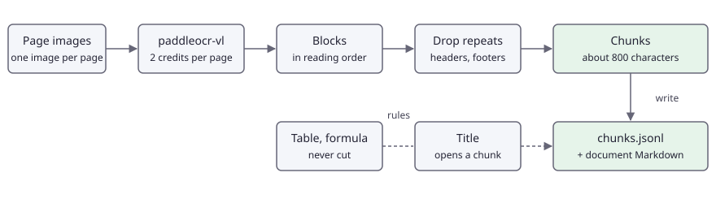

# Scanned documents to Markdown chunks for a search index

English | [简体中文](README.zh-CN.md)

Parse every page of a scanned or photographed document with `paddleocr-vl`, remove the headers and footers that repeat across pages, and cut the text into chunks that keep tables whole and carry the page, the box and the heading path they came from. The output is a JSONL file you can feed to any embedding model and vector store.

## Problem <!-- #problem -->

A search index over documents needs text in pieces of a useful size, and a way to point back at the page a piece came from. A scan gives you neither: it is a picture, often tilted and unevenly lit, and a plain OCR text dump loses the structure that makes a piece findable and quotable.

The constraints that shape the code:

- **Stack does not provide text embeddings.** This use case produces the chunks and stops there. Embed the `text` of each chunk with a model of your own and store the vector next to the chunk `id`.
- **The API takes one page image per call.** A document of many pages is many calls, so pages are read concurrently (2 at a time by default), and one bad page must not stop the rest.
- **Chunk boundaries decide retrieval quality.** A heading should open a chunk, a table must never be cut in half (half a table answers nothing), and a paragraph that is too long is cut where a sentence ends.
- **Running headers and footers are noise.** "Wealth of Nations, Book I" and "Page 2 of 3" on every page would be indexed again and again, and would match queries they should not match. They repeat across pages, so they can be found by comparing pages of the same document.
- **Every hit must cite its source.** Each chunk keeps its page number, the merged box of its blocks, the types of the blocks and the sha256 of the page file.
- **Cost is per page.** `paddleocr-vl` costs 2 credits per page, so 1,000 pages cost 2,000 credits at list price.

## Pipeline <!-- #pipeline -->

<!-- figure: assets/pipeline.svg -->


1. Take the page images (the dataset is images; for a PDF, render each page first, see "Adapt it").
2. Upload each page once (`POST /v1/images`, free) and call `POST /v1/documents/parse` with `paddleocr-vl` and `options.blocks: true`: layout blocks (`title`, `text`, `table`, `formula`, `header`, `footer`, ...) with boxes, in reading order, tables as HTML and formulas as LaTeX.
3. Sort the blocks by `order`. For every document, find the `header` and `footer` blocks whose text (digits blanked) appears on at least two pages and drop them.
4. Cut chunks page by page: a title starts a new chunk; text is packed to about 800 characters and cut at sentence ends when a block is longer; a table or formula is never cut; a chunk never crosses a page.
5. Write `chunks.jsonl` (one chunk per line), one Markdown file per document under `documents/`, and `result.json`.

The output of one page is described by `output.schema.json`. A chunk looks like this:

```json
{"id": "d01-c0002", "document": "d01", "page": 2, "text": "## 2. The pin workshop\n\nTable 1. ...",
 "chars": 498, "headings": ["The Division of Labour", "2. The pin workshop"], "blockTypes": ["title", "caption", "table"],
 "bbox": [120, 281, 1119, 884], "blocks": [[2, 1], [2, 2], [2, 3]], "sha256": "..."}
```

## Run it <!-- #run -->

```bash
export FOLDBUN_API_KEY="fbs_..."
export FOLDBUN_MAX_CREDITS=4           # optional: the client refuses calls that could pass it
cd use-cases/04-documents-to-rag-chunks/python
uv run main.py --out out               # the 2 smoke pages: 4 credits at list price
uv run main.py --out out --resume      # after an interruption: pages already read are not read again
uv run main.py --out out --chunk-size 1200   # a different target chunk size
```

Arguments: `--manifest`, `--out`, `--concurrency` (default 2), `--limit`, `--resume`, `--chunk-size` (default 800), `--pdf FILE`. Outputs: `result.json` (format of `contract/result.schema.json`), `chunks.jsonl`, `documents/<document>.md` and `items/` (one small file per page read, which `--resume` uses).

Without a key the program exits with code 2 and the standard message. On a new account `paddleocr-vl` answers `403 model_locked` (it is in the paid pool): the run stops with exit code 3.

To score a run: `python evaluate.py --result out/result.json --truth assets/smoke/truth.json`.

The full set (30 pages: 15 clean and the same 15 photographed, 8 MB) is a release asset of the repository (see `datasets/README.md`). Its manifest is committed as `assets/full.json`; the images and the ground truth are in the archive.

```bash
tar xzf 04-documents-to-rag-chunks-full.tar.gz -C use-cases/04-documents-to-rag-chunks/assets
export FOLDBUN_API_KEY="fbs_..."
uv run python -m harness live --size full --uc 04 --max-credits 60 --dry-run   # the plan, nothing is sent
uv run python -m harness refresh --size full --uc 04 --max-credits 60          # runs, scores, writes expected/full.json and expected/full-summary.json
```

In the full manifest the clean and the photographed copies are separate documents (`d01` and `d01-photo`). In the smoke manifest the two pages both belong to document `d01` (page 2 clean, page 3 photographed), so the header and footer that repeat across them are removed.

## Code <!-- #code -->

### Idempotency and the call <!-- #code-call -->

<!-- code: idempotency -->
<details><summary>Python (python/main.py)</summary>

```python
def idempotency_key(image_sha256: str) -> str:
    """Same file, same key (at most 128 printable ASCII characters). Within 24 hours the API replays the stored answer for a
    repeated key without running or charging the call, so a restarted run is free. The key names this program ("py")."""
    return f"r04-py-{image_sha256}-parse"
```

</details>
<!-- /code -->

<!-- code: parse-call -->
<details><summary>Python (python/main.py)</summary>

```python
def parse_page(client: sc.StackClient, handle: str, sha: str, tag: str) -> dict:
    """One page, one call: layout blocks in reading order and the page as Markdown (2 credits)."""
    return client.post(
        "/v1/documents/parse",
        {"model": MODEL, "image": sc.image_handle(handle), "options": {"blocks": True}},
        idempotency_key=idempotency_key(sha),
        tag=tag,
    )
```

</details>
<!-- /code -->

### Retries, concurrency and resume <!-- #code-run -->

One page at a time is retried, so a failing page never stops the others. `bad_model_output` means the model could not read that page: the same image gives the same failure, so it is not retried; the page is recorded as an error and the document goes on without it.

<!-- code: page-retry -->
<details><summary>Python (python/main.py)</summary>

```python
def read_page(client: sc.StackClient, item: dict, base: Path) -> dict:
    """Read one page. The client already retries what the API marks `retryable`; a page that still fails after that gets
    two more attempts here, one page at a time, so one bad page never stops the others. `bad_model_output` is not retried
    (the same image gives the same failure): it is recorded as the page's error and the page is skipped."""
    data = (base / item["image"]).read_bytes()
    sha = hashlib.sha256(data).hexdigest()
    handle = client.upload(data, content_type(item["image"]))["id"]  # free
    for attempt in range(1, PAGE_ATTEMPTS + 1):
        try:
            page = parse_page(client, handle, sha, item["id"])
            blocks = [{k: b[k] for k in ("type", "order", "bbox", "text", "markdown") if k in b} for b in page.get("blocks", [])]
            return {
                "id": item["id"],
                "status": "ok",
                "calls": client.calls(item["id"]),
                "_sha256": sha,
                "_page": item["page"],
                "_document": item["document"],
                "output": {"markdown": page["markdown"], "blocks": blocks},
            }
        except sc.StackError as err:
            if err.code in ("model_locked", "budget_exceeded") or err.code == "bad_model_output" or attempt == PAGE_ATTEMPTS or not err.retryable:
                raise
            time.sleep(min(2.0 * attempt, 10.0))
    raise AssertionError("unreachable")
```

</details>
<!-- /code -->

<!-- code: concurrency -->
<details><summary>Python (python/main.py)</summary>

```python
# `--concurrency` pages are in flight (default 2); the client also spaces calls by the model's per-minute limit.
code, lock = 0, threading.Lock()
with ThreadPoolExecutor(max_workers=args.concurrency) as pool:
    futures = {pool.submit(read_page, client, item, base): item for item in todo}
    for future in as_completed(futures):
        item = futures[future]
        try:
            entry = future.result()
        except sc.StackError as err:
            print(f"{item['id']}: {err.status} {err.code}: {err.message}" + (f" (request {err.request_id})" if err.request_id else ""), file=sys.stderr)
            if err.code in ("model_locked", "budget_exceeded"):
                code = EXIT_TIER if err.code == "model_locked" else EXIT_BUDGET
                for f in futures:
                    f.cancel()
                continue
            entry = {
                "id": item["id"],
                "status": "error",
                "calls": client.calls(item["id"]),
                "output": None,
                "error": {"status": err.status, "code": err.code, "message": err.message},
            }
        entries[item["id"]] = entry
        if entry["status"] == "ok":
            save_done(args.out, entry)
            with lock:
                print(f"{item['id']}: {len(entry['output']['blocks'])} blocks")
```

</details>
<!-- /code -->

<!-- code: resume -->
<details><summary>Python (python/main.py)</summary>

```python
def item_file(out: Path, item_id: str) -> Path:
    return out / "items" / f"{item_id}.json"


def load_done(out: Path, item: dict, base: Path) -> dict | None:
    """The saved entry of a page read by an earlier run of this directory, when the file and the entry format are unchanged."""
    path = item_file(out, item["id"])
    if not path.exists():
        return None
    saved = json.loads(path.read_text())
    key = [hashlib.sha256((base / item["image"]).read_bytes()).hexdigest(), PIPELINE]
    return saved["entry"] if saved["key"] == key and saved["entry"]["status"] == "ok" else None


def save_done(out: Path, entry: dict):
    """One small file per page read, written atomically, so a killed run loses at most the pages in flight."""
    path = item_file(out, entry["id"])
    path.parent.mkdir(parents=True, exist_ok=True)
    tmp = path.with_suffix(".tmp")
    tmp.write_text(json.dumps({"key": [entry["_sha256"], PIPELINE], "entry": entry}))
    os.replace(tmp, path)
```

</details>
<!-- /code -->

### Headers and footers that repeat <!-- #code-dedup -->

<!-- code: dedup -->
<details><summary>Python (python/chunker.py)</summary>

```python
def furniture_key(block: dict) -> str:
    """The text of a header or footer with its digits blanked, so "Page 2 of 3" and "Page 3 of 3" are the same line."""
    return re.sub(r"\d+", "#", squash(block.get("text", ""))).lower()


def mark_repeated(pages: list[dict]) -> int:
    """Flag the header and footer blocks whose text appears on at least two pages of the document.

    `pages` are the successfully read pages of ONE document: {"page": n, "blocks": [...]}. A flagged block gets
    `dropped: "repeated_header_footer"` and is left out of the chunks and of document.md. A header seen on one page
    only is kept: nothing says it is page furniture. Returns the number of flagged blocks."""
    seen: dict[tuple[str, str], set[int]] = {}
    for page in pages:
        for block in page["blocks"]:
            if block["type"] in FURNITURE and furniture_key(block):
                seen.setdefault((block["type"], furniture_key(block)), set()).add(page["page"])
    flagged = 0
    for page in pages:
        for block in page["blocks"]:
            block.pop("dropped", None)
            if block["type"] in FURNITURE and len(seen.get((block["type"], furniture_key(block)), ())) >= 2:
                block["dropped"] = "repeated_header_footer"
                flagged += 1
    return flagged
```

</details>
<!-- /code -->

### Chunking <!-- #code-chunk -->

<!-- code: split-text -->
<details><summary>Python (python/chunker.py)</summary>

```python
def split_text(text: str, limit: int) -> list[str]:
    """Pieces of at most `limit` characters, cut at sentence ends; a sentence longer than the limit is cut at a space."""
    pieces, cur = [], ""
    for sentence in SENTENCE.split(text):
        while len(sentence) > limit:
            cut = sentence.rfind(" ", 0, limit)
            cut = cut if cut > 0 else limit
            if cur:
                pieces.append(cur)
                cur = ""
            pieces.append(sentence[:cut].strip())
            sentence = sentence[cut:].strip()
        if cur and len(cur) + 1 + len(sentence) > limit:
            pieces.append(cur)
            cur = ""
        cur = f"{cur} {sentence}".strip()
    return pieces + [cur] if cur else pieces
```

</details>
<!-- /code -->

<!-- code: chunk-page -->
<details><summary>Python (python/chunker.py)</summary>

```python
def chunk_page(blocks: list[dict], page: int, headings: list[tuple[int, str]], target: int = TARGET) -> tuple[list[dict], list[tuple[int, str]]]:
    """Chunks of one page. `headings` is the stack of (level, text) the previous pages left open; the new stack is returned.

    - A title closes the chunk in progress and opens a new one, which starts with the heading.
    - Text is packed up to `target` characters; a block longer than that is cut at sentence ends first.
    - Tables and formulas are never cut. One that does not fit in the chunk in progress starts a new chunk, and a table
      longer than `target` is a chunk of its own.
    - A chunk never crosses a page boundary, so `page` and `bbox` are exact.
    """
    chunks: list[dict] = []
    cur: dict | None = None

    def flush():
        nonlocal cur
        if cur and cur["parts"]:
            chunks.append(cur)
        cur = None

    def open_chunk():
        nonlocal cur
        cur = {"parts": [], "blocks": [], "types": [], "boxes": [], "headings": [t for _, t in headings]}

    def add(text: str, block: dict):
        nonlocal cur
        if cur is None:
            open_chunk()
        cur["parts"].append(text)
        if [block["order"]] not in [b[1:] for b in cur["blocks"]]:
            cur["blocks"].append([page, block["order"]])
        if block["type"] not in cur["types"]:
            cur["types"].append(block["type"])
        cur["boxes"].append(block["bbox"])

    def size() -> int:
        return len("\n\n".join(cur["parts"])) if cur else 0

    for block in sorted((b for b in blocks if not b.get("dropped")), key=lambda b: b["order"]):
        text = block_text(block)
        if not text:
            continue
        if block["type"] == "title":
            level = heading_level(block)
            headings = [h for h in headings if h[0] < level] + [(level, squash(block["text"]))]
            flush()
            open_chunk()
            add(text, block)
        elif block["type"] in ATOMIC:
            if cur and size() + 2 + len(text) > target:
                flush()
            add(text, block)
            if len(text) > target:
                flush()
        else:
            for piece in split_text(text, target):
                if cur and size() + 2 + len(piece) > target:
                    flush()
                add(piece, block)
    flush()
    out = []
    for c in chunks:
        xs = [b[0] for b in c["boxes"]], [b[1] for b in c["boxes"]], [b[2] for b in c["boxes"]], [b[3] for b in c["boxes"]]
        text = "\n\n".join(c["parts"])
        out.append(
            {
                "page": page,
                "text": text,
                "chars": len(text),
                "headings": c["headings"],
                "blockTypes": c["types"],
                "bbox": [min(xs[0]), min(xs[1]), max(xs[2]), max(xs[3])],
                "blocks": c["blocks"],
            }
        )
    return out, headings
```

</details>
<!-- /code -->

<!-- code: write-chunks -->
<details><summary>Python (python/main.py)</summary>

```python
with (args.out / "chunks.jsonl").open("w") as f:
    for doc in by_doc:
        for chunk in chunks_of[doc]:
            f.write(json.dumps(chunk, ensure_ascii=False) + "\n")
```

</details>
<!-- /code -->

## Results <!-- #results -->

The numbers come from `evaluate.py`. Text is scored as the normalised edit distance (NED, 0 is perfect) of the text of all blocks except tables and formulas; tables as the F1 of their cells (a cell counts when its row, column and text match); reading order as the Kendall tau between the model's block order and the true order; and the chunks by their size and by whether any table was cut. Every page exists as a clean render and as a photographed variant, so each metric is also given per variant. No latency is reported: a time measured through a client's network says little about the service.

Until a live run is recorded the offline result in `expected/offline.json` shows how the pipeline behaves with hand-written answers; it says nothing about the model.

Smoke set (2 pages):

<!-- metrics: expected/smoke-summary.json -->
Not measured yet.
<!-- /metrics -->

Full set (30 pages):

<!-- metrics: expected/full-summary.json -->
Not measured yet.
<!-- /metrics -->

## Cost <!-- #cost -->

One page is one `paddleocr-vl` call at 2 credits, whatever the page contains: 2,000 credits per 1,000 pages at list price. The cost per 1,000 pages in the table is computed with every page at list price. For large batches of plain text, `ppocr-v6` costs 0.25 credits per image (see use case 03) but returns lines without layout, tables or reading order.

<!-- cost -->
Not measured yet.
<!-- /cost -->

- A call that fails is not charged, and a repeated idempotency key within 24 hours is replayed without being charged, so `--resume` and reruns cost nothing for pages already read.
- Chunking runs on your machine and costs nothing; changing `--chunk-size` needs no new calls once the pages are saved in `items/` (use `--resume`).

See [Document parsing](https://stack.foldbun.com/docs/use-cases/document-parsing/), [Rate limits](https://stack.foldbun.com/docs/rate-limits/) and [Billing](https://stack.foldbun.com/docs/billing/) in the documentation.

## Adapt it <!-- #adapt -->

- **Your own pages:** write a manifest with `items[]` of `{"id", "image", "document", "page"}`, where `document` groups the pages of one file and `page` is the page number you want in citations. Without `document` every image is its own document.
- **Your own PDFs:** the API takes one page image per call, so render the pages first. `python main.py --pdf report.pdf --out out` does it with `pypdfium2` (install it with `uv sync --extra pdf` or `pip install pypdfium2`) at 150 dpi, writes the images to `out/pages/` and processes them as one document. The `pdf-pages` region of `main.py` is the whole of it; at 150 dpi an A4 page is 1240 x 1754 px, well under the 4,096 px that the OCR models accept.
- **Chunk size:** `--chunk-size`. A smaller size gives more precise hits and more vectors; embedding models differ in the length they handle well, so set it from yours.
- **Other block types:** `figure` is never cut; `list` and `caption` are treated as text.
- **Embeddings:** none are computed here. Embed `chunk["text"]` with your own model and keep `id`, `document`, `page` and `sha256` as the metadata of the vector.

## Limits and when not to use this <!-- #limits -->

- **Multi-column pages.** Reading order inside a single column is reliable; complex multi-column journal layouts sometimes come back in the wrong order, and then chunks mix columns. The reading-order tau on the set shows it only for the pages in it, which are single-column.
- **Handwriting** is out of scope.
- **No text embeddings** and no vector store: only chunks.
- **Headers and footers are removed by comparison.** A document with a single page, or a header whose text changes on every page (a chapter title), is not detected as repeating and stays in the chunks.
- **Chunks do not cross pages.** A paragraph that continues on the next page is two chunks; the cost is some short chunks at the end of a page.
- **Formulas** come back as LaTeX and are kept whole, but the model's reading of a formula is not always exact.
- **Large plain-text batches** are cheaper with `ppocr-v6` (0.25 credits per image) when you do not need tables, formulas or reading order.
- **Photographs** with strong tilt, shadow or blur read worse than clean renders; the gap between the two variants is reported.
- **Two readings of the same image can differ slightly** between runs.

## Data <!-- #data -->

The set is synthetic and made by `datasets/generators/documents.py` (CC0): six fictional documents of 2 to 3 pages, laid out with Pillow, 15 pages in all, each as a clean render and as a photographed variant (perspective, rotation, uneven light, blur, noise, JPEG), 30 images of up to 1754 px. The body text is excerpted from public-domain books (Adam Smith, Charles Darwin, Henry David Thoreau, Albert Einstein in the 1920 translation); the headings, running headers, footers, tables (invented figures, labelled as such) and formulas are generated. Ground truth per page: the blocks in reading order with boxes, the table cells and the page as Markdown. The smoke set is page 2 of `d01` (clean, with a table) and page 3 of the photographed variant. Attribution: `assets/smoke/ATTRIBUTION.csv`; sources and licences: `datasets/LICENSES.md`.
