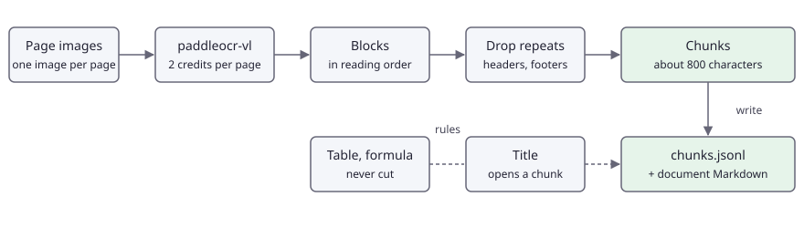

<!-- en-sha: 7bd616cded1a -->
# 扫描文档转为可入索引的 Markdown 切块

[English](README.md) | 简体中文

用 `paddleocr-vl` 解析扫描件或翻拍文档的每一页，去掉跨页重复的页眉页脚，再把正文切成块：表格整块保留，每块都带着它所在的页码、位置框和标题路径。输出是一个 JSONL 文件，可以直接交给任何嵌入模型和向量库。

## 问题 <!-- #problem -->

文档搜索索引需要大小合适的文本块，还要能指回文本所在的页。扫描件两样都不给：它是一张图片，常常倾斜、光照不均；单纯倒出一份 OCR 文本，会丢掉让文本块可检索、可引用的结构。

决定代码形态的约束：

- **Stack 不提供文本嵌入。** 本用例只产出切块，到此为止。请用自己的模型对每个切块的 `text` 做嵌入，把向量与切块的 `id` 存在一起。
- **API 每次调用只收一页图片。** 多页文档就是多次调用，所以页面并发读取（默认同时 2 页），而且一页出错不能拖垮其余页。
- **切块边界决定检索质量。** 标题应当开启新块；表格绝不能从中间切开（半张表答不了任何问题）；过长的段落在句末切开。
- **页眉页脚是噪声。** 每页都有的「Wealth of Nations, Book I」和「Page 2 of 3」会被反复索引，还会匹配到不该匹配的查询。它们跨页重复，所以可以通过比较同一文档的各页找出来。
- **每个命中都要能注明出处。** 每个切块保留页码、其中各块的合并框、块的类型和页面文件的 sha256。
- **成本按页计。** `paddleocr-vl` 每页 2 credits，按标价 1,000 页是 2,000 credits。

## 流程 <!-- #pipeline -->

<!-- figure: assets/pipeline.svg -->


1. 取页面图片（数据集就是图片；PDF 要先逐页渲染，见「改成自己的数据」）。
2. 每页上传一次（`POST /v1/images`，免费），再用 `paddleocr-vl` 和 `options.blocks: true` 调用 `POST /v1/documents/parse`：按阅读顺序返回带框的版面块（`title`、`text`、`table`、`formula`、`header`、`footer` 等），表格为 HTML，公式为 LaTeX。
3. 按 `order` 给块排序。对每份文档，找出文本（数字替换为占位符后）至少在两页出现的 `header` 和 `footer` 块，并去掉。
4. 逐页切块：标题开启新块；正文累积到约 800 个字符，某个块更长时在句末切开；表格和公式绝不切开；一个块不跨页。
5. 写出 `chunks.jsonl`（每行一个切块）、`documents/` 下每份文档一个 Markdown 文件，以及 `result.json`。

一页的输出由 `output.schema.json` 描述。一个切块长这样：

```json
{"id": "d01-c0002", "document": "d01", "page": 2, "text": "## 2. The pin workshop\n\nTable 1. ...",
 "chars": 498, "headings": ["The Division of Labour", "2. The pin workshop"], "blockTypes": ["title", "caption", "table"],
 "bbox": [120, 281, 1119, 884], "blocks": [[2, 1], [2, 2], [2, 3]], "sha256": "..."}
```

## 运行 <!-- #run -->

```bash
export FOLDBUN_API_KEY="fbs_..."
export FOLDBUN_MAX_CREDITS=4           # 可选：客户端会拒绝可能超出该额度的调用
cd use-cases/04-documents-to-rag-chunks/python
uv run main.py --out out               # 2 张 smoke 页面：按标价 4 credits
uv run main.py --out out --resume      # 中断之后：已读过的页面不再重读
uv run main.py --out out --chunk-size 1200   # 换一个目标块大小
```

参数：`--manifest`、`--out`、`--concurrency`（默认 2）、`--limit`、`--resume`、`--chunk-size`（默认 800）、`--pdf FILE`。输出：`result.json`（格式见 `contract/result.schema.json`）、`chunks.jsonl`、`documents/<document>.md`，以及 `items/`（每读完一页存一个小文件，`--resume` 用它）。

没有密钥时程序以退出码 2 退出并打印标准提示。新账户调用 `paddleocr-vl` 会得到 `403 model_locked`（它在付费池）：运行以退出码 3 停止。

给一次运行打分：`python evaluate.py --result out/result.json --truth assets/smoke/truth.json`。

完整集（30 页：15 页干净版和同样 15 页的翻拍版，8 MB）是仓库的发布附件（见 `datasets/README.md`）。它的清单提交为 `assets/full.json`，图片和真值在压缩包里。

```bash
tar xzf 04-documents-to-rag-chunks-full.tar.gz -C use-cases/04-documents-to-rag-chunks/assets
export FOLDBUN_API_KEY="fbs_..."
uv run python -m harness live --size full --uc 04 --max-credits 60 --dry-run   # 只看计划，不发任何请求
uv run python -m harness refresh --size full --uc 04 --max-credits 60          # 运行、打分，写出 expected/full.json 和 expected/full-summary.json
```

完整清单里，干净版和翻拍版是各自独立的文档（`d01` 和 `d01-photo`）。smoke 清单里的两页都属于文档 `d01`（第 2 页是干净版，第 3 页是翻拍版），所以跨这两页重复的页眉页脚会被去掉。

## 代码 <!-- #code -->

### 幂等与调用 <!-- #code-call -->

<!-- code: idempotency -->
<details><summary>Python (python/main.py)</summary>

```python
def idempotency_key(image_sha256: str) -> str:
    """Same file, same key (at most 128 printable ASCII characters). Within 24 hours the API replays the stored answer for a
    repeated key without running or charging the call, so a restarted run is free. The key names this program ("py")."""
    return f"r04-py-{image_sha256}-parse"
```

</details>
<!-- /code -->

<!-- code: parse-call -->
<details><summary>Python (python/main.py)</summary>

```python
def parse_page(client: sc.StackClient, handle: str, sha: str, tag: str) -> dict:
    """One page, one call: layout blocks in reading order and the page as Markdown (2 credits)."""
    return client.post(
        "/v1/documents/parse",
        {"model": MODEL, "image": sc.image_handle(handle), "options": {"blocks": True}},
        idempotency_key=idempotency_key(sha),
        tag=tag,
    )
```

</details>
<!-- /code -->

### 重试、并发与续跑 <!-- #code-run -->

重试按页进行，所以一页失败不会拖垮其他页。`bad_model_output` 表示模型读不了这一页：同一张图会得到同样的失败，因此不重试；这一页记为错误，文档继续处理其余页。

<!-- code: page-retry -->
<details><summary>Python (python/main.py)</summary>

```python
def read_page(client: sc.StackClient, item: dict, base: Path) -> dict:
    """Read one page. The client already retries what the API marks `retryable`; a page that still fails after that gets
    two more attempts here, one page at a time, so one bad page never stops the others. `bad_model_output` is not retried
    (the same image gives the same failure): it is recorded as the page's error and the page is skipped."""
    data = (base / item["image"]).read_bytes()
    sha = hashlib.sha256(data).hexdigest()
    handle = client.upload(data, content_type(item["image"]))["id"]  # free
    for attempt in range(1, PAGE_ATTEMPTS + 1):
        try:
            page = parse_page(client, handle, sha, item["id"])
            blocks = [{k: b[k] for k in ("type", "order", "bbox", "text", "markdown") if k in b} for b in page.get("blocks", [])]
            return {
                "id": item["id"],
                "status": "ok",
                "calls": client.calls(item["id"]),
                "_sha256": sha,
                "_page": item["page"],
                "_document": item["document"],
                "output": {"markdown": page["markdown"], "blocks": blocks},
            }
        except sc.StackError as err:
            if err.code in ("model_locked", "budget_exceeded") or err.code == "bad_model_output" or attempt == PAGE_ATTEMPTS or not err.retryable:
                raise
            time.sleep(min(2.0 * attempt, 10.0))
    raise AssertionError("unreachable")
```

</details>
<!-- /code -->

<!-- code: concurrency -->
<details><summary>Python (python/main.py)</summary>

```python
# `--concurrency` pages are in flight (default 2); the client also spaces calls by the model's per-minute limit.
code, lock = 0, threading.Lock()
with ThreadPoolExecutor(max_workers=args.concurrency) as pool:
    futures = {pool.submit(read_page, client, item, base): item for item in todo}
    for future in as_completed(futures):
        item = futures[future]
        try:
            entry = future.result()
        except sc.StackError as err:
            print(f"{item['id']}: {err.status} {err.code}: {err.message}" + (f" (request {err.request_id})" if err.request_id else ""), file=sys.stderr)
            if err.code in ("model_locked", "budget_exceeded"):
                code = EXIT_TIER if err.code == "model_locked" else EXIT_BUDGET
                for f in futures:
                    f.cancel()
                continue
            entry = {
                "id": item["id"],
                "status": "error",
                "calls": client.calls(item["id"]),
                "output": None,
                "error": {"status": err.status, "code": err.code, "message": err.message},
            }
        entries[item["id"]] = entry
        if entry["status"] == "ok":
            save_done(args.out, entry)
            with lock:
                print(f"{item['id']}: {len(entry['output']['blocks'])} blocks")
```

</details>
<!-- /code -->

<!-- code: resume -->
<details><summary>Python (python/main.py)</summary>

```python
def item_file(out: Path, item_id: str) -> Path:
    return out / "items" / f"{item_id}.json"


def load_done(out: Path, item: dict, base: Path) -> dict | None:
    """The saved entry of a page read by an earlier run of this directory, when the file and the entry format are unchanged."""
    path = item_file(out, item["id"])
    if not path.exists():
        return None
    saved = json.loads(path.read_text())
    key = [hashlib.sha256((base / item["image"]).read_bytes()).hexdigest(), PIPELINE]
    return saved["entry"] if saved["key"] == key and saved["entry"]["status"] == "ok" else None


def save_done(out: Path, entry: dict):
    """One small file per page read, written atomically, so a killed run loses at most the pages in flight."""
    path = item_file(out, entry["id"])
    path.parent.mkdir(parents=True, exist_ok=True)
    tmp = path.with_suffix(".tmp")
    tmp.write_text(json.dumps({"key": [entry["_sha256"], PIPELINE], "entry": entry}))
    os.replace(tmp, path)
```

</details>
<!-- /code -->

### 跨页重复的页眉页脚 <!-- #code-dedup -->

<!-- code: dedup -->
<details><summary>Python (python/chunker.py)</summary>

```python
def furniture_key(block: dict) -> str:
    """The text of a header or footer with its digits blanked, so "Page 2 of 3" and "Page 3 of 3" are the same line."""
    return re.sub(r"\d+", "#", squash(block.get("text", ""))).lower()


def mark_repeated(pages: list[dict]) -> int:
    """Flag the header and footer blocks whose text appears on at least two pages of the document.

    `pages` are the successfully read pages of ONE document: {"page": n, "blocks": [...]}. A flagged block gets
    `dropped: "repeated_header_footer"` and is left out of the chunks and of document.md. A header seen on one page
    only is kept: nothing says it is page furniture. Returns the number of flagged blocks."""
    seen: dict[tuple[str, str], set[int]] = {}
    for page in pages:
        for block in page["blocks"]:
            if block["type"] in FURNITURE and furniture_key(block):
                seen.setdefault((block["type"], furniture_key(block)), set()).add(page["page"])
    flagged = 0
    for page in pages:
        for block in page["blocks"]:
            block.pop("dropped", None)
            if block["type"] in FURNITURE and len(seen.get((block["type"], furniture_key(block)), ())) >= 2:
                block["dropped"] = "repeated_header_footer"
                flagged += 1
    return flagged
```

</details>
<!-- /code -->

### 切块 <!-- #code-chunk -->

<!-- code: split-text -->
<details><summary>Python (python/chunker.py)</summary>

```python
def split_text(text: str, limit: int) -> list[str]:
    """Pieces of at most `limit` characters, cut at sentence ends; a sentence longer than the limit is cut at a space."""
    pieces, cur = [], ""
    for sentence in SENTENCE.split(text):
        while len(sentence) > limit:
            cut = sentence.rfind(" ", 0, limit)
            cut = cut if cut > 0 else limit
            if cur:
                pieces.append(cur)
                cur = ""
            pieces.append(sentence[:cut].strip())
            sentence = sentence[cut:].strip()
        if cur and len(cur) + 1 + len(sentence) > limit:
            pieces.append(cur)
            cur = ""
        cur = f"{cur} {sentence}".strip()
    return pieces + [cur] if cur else pieces
```

</details>
<!-- /code -->

<!-- code: chunk-page -->
<details><summary>Python (python/chunker.py)</summary>

```python
def chunk_page(blocks: list[dict], page: int, headings: list[tuple[int, str]], target: int = TARGET) -> tuple[list[dict], list[tuple[int, str]]]:
    """Chunks of one page. `headings` is the stack of (level, text) the previous pages left open; the new stack is returned.

    - A title closes the chunk in progress and opens a new one, which starts with the heading.
    - Text is packed up to `target` characters; a block longer than that is cut at sentence ends first.
    - Tables and formulas are never cut. One that does not fit in the chunk in progress starts a new chunk, and a table
      longer than `target` is a chunk of its own.
    - A chunk never crosses a page boundary, so `page` and `bbox` are exact.
    """
    chunks: list[dict] = []
    cur: dict | None = None

    def flush():
        nonlocal cur
        if cur and cur["parts"]:
            chunks.append(cur)
        cur = None

    def open_chunk():
        nonlocal cur
        cur = {"parts": [], "blocks": [], "types": [], "boxes": [], "headings": [t for _, t in headings]}

    def add(text: str, block: dict):
        nonlocal cur
        if cur is None:
            open_chunk()
        cur["parts"].append(text)
        if [block["order"]] not in [b[1:] for b in cur["blocks"]]:
            cur["blocks"].append([page, block["order"]])
        if block["type"] not in cur["types"]:
            cur["types"].append(block["type"])
        cur["boxes"].append(block["bbox"])

    def size() -> int:
        return len("\n\n".join(cur["parts"])) if cur else 0

    for block in sorted((b for b in blocks if not b.get("dropped")), key=lambda b: b["order"]):
        text = block_text(block)
        if not text:
            continue
        if block["type"] == "title":
            level = heading_level(block)
            headings = [h for h in headings if h[0] < level] + [(level, squash(block["text"]))]
            flush()
            open_chunk()
            add(text, block)
        elif block["type"] in ATOMIC:
            if cur and size() + 2 + len(text) > target:
                flush()
            add(text, block)
            if len(text) > target:
                flush()
        else:
            for piece in split_text(text, target):
                if cur and size() + 2 + len(piece) > target:
                    flush()
                add(piece, block)
    flush()
    out = []
    for c in chunks:
        xs = [b[0] for b in c["boxes"]], [b[1] for b in c["boxes"]], [b[2] for b in c["boxes"]], [b[3] for b in c["boxes"]]
        text = "\n\n".join(c["parts"])
        out.append(
            {
                "page": page,
                "text": text,
                "chars": len(text),
                "headings": c["headings"],
                "blockTypes": c["types"],
                "bbox": [min(xs[0]), min(xs[1]), max(xs[2]), max(xs[3])],
                "blocks": c["blocks"],
            }
        )
    return out, headings
```

</details>
<!-- /code -->

<!-- code: write-chunks -->
<details><summary>Python (python/main.py)</summary>

```python
with (args.out / "chunks.jsonl").open("w") as f:
    for doc in by_doc:
        for chunk in chunks_of[doc]:
            f.write(json.dumps(chunk, ensure_ascii=False) + "\n")
```

</details>
<!-- /code -->

## 结果 <!-- #results -->

数字来自 `evaluate.py`。文本用归一化编辑距离（NED，0 为完美）评分，对象是除表格和公式外所有块的文本；表格用单元格 F1（行、列和文本都一致才算对）；阅读顺序用模型的块顺序与真实顺序之间的 Kendall tau；切块看大小以及有没有表格被切开。每一页都有干净版和翻拍版，所以每项指标也分别给出两种版本。不报告延迟：经客户端网络测得的时间说明不了服务本身的情况。

在记录到线上实测之前，`expected/offline.json` 里的离线结果只展示流水线在手写应答下的行为，不能说明模型的表现。

smoke 集（2 页）：

<!-- metrics: expected/smoke-summary.json -->
尚未实测。
<!-- /metrics -->

完整集（30 页）：

<!-- metrics: expected/full-summary.json -->
| 指标 | 数值 |
|---|---|
| `pages` | 30 |
| `pages_scored` | 30 |
| `pages_failed` | 0 |
| `text_ned` | 0.0015 |
| `table_cell_f1` | 1 |
| `reading_order_tau` | 0.9976 |
| `text_ned_clean` | 0.0018 |
| `table_cell_f1_clean` | 1 |
| `reading_order_tau_clean` | 0.9952 |
| `text_ned_photographed` | 0.0012 |
| `table_cell_f1_photographed` | 1 |
| `reading_order_tau_photographed` | 1 |
| `formula_recall` | 1 |
| `tables_found_rate` | 1 |
| `text_ned_gap` | -0.0006 |
| `table_cell_f1_gap` | 0 |
| `chunks` | 120 |
| `chunks_per_page` | 4 |
| `chunk_chars_p10` | 63 |
| `chunk_chars_p50` | 499 |
| `chunk_chars_p90` | 758 |
| `chunk_chars_max` | 781 |
| `tables_in_chunks` | 16 |
| `tables_split` | 0 |
| `blocks_dropped` | 85 |
| `cost_per_1000_pages_list` | 2,000 |
<!-- /metrics -->

## 成本 <!-- #cost -->

一页就是一次 `paddleocr-vl` 调用，2 credits，页面内容是什么都一样：按标价 1,000 页 2,000 credits。表中每 1,000 页成本按每页都是标价计算。大批量纯文本可以考虑 `ppocr-v6`，每张图 0.25 credits（见用例 03），但它只返回文字行，没有版面、表格和阅读顺序。

<!-- cost -->
| 运行 | 调用次数 | 标价（credits） | 实扣（credits） |
|---|---|---|---|
| smoke | 2 | 4 | 4 |
| full | 30 | 56 | 56 |
<!-- /cost -->

- 失败的调用不扣费；24 小时内重复的幂等键只回放、不扣费，所以 `--resume` 和重跑不会为已读过的页面再付钱。
- 切块在本机运行，不花钱；页面存入 `items/` 之后，改 `--chunk-size` 不需要新的调用（配合 `--resume`）。

参见文档里的[文档解析](https://stack.foldbun.com/docs/use-cases/document-parsing/)、[速率限制](https://stack.foldbun.com/docs/rate-limits/)和[计费](https://stack.foldbun.com/docs/billing/)。

## 改成自己的数据 <!-- #adapt -->

- **自己的页面：** 写一份清单，`items[]` 里每项是 `{"id", "image", "document", "page"}`，`document` 把同一份文件的各页归在一起，`page` 是你想在引用里用的页码。没有 `document` 时，每张图片是独立的一份文档。
- **自己的 PDF：** API 每次调用只收一页图片，所以要先逐页渲染。`python main.py --pdf report.pdf --out out` 用 `pypdfium2`（用 `uv sync --extra pdf` 或 `pip install pypdfium2` 安装）按 150 dpi 渲染，把图片写到 `out/pages/`，并把它们当作一份文档处理。`main.py` 的 `pdf-pages` 区域就是全部实现；150 dpi 下 A4 页面是 1240 x 1754 px，远低于 OCR 模型接受的 4,096 px。
- **块大小：** `--chunk-size`。更小的块命中更精确，向量也更多；各嵌入模型擅长处理的长度不同，请按你的模型设置。
- **其他块类型：** `figure` 绝不切开；`list` 和 `caption` 按正文处理。
- **嵌入：** 这里不计算嵌入。请用自己的模型对 `chunk["text"]` 做嵌入，并把 `id`、`document`、`page` 和 `sha256` 作为向量的元数据保存。

## 局限与何时不该用 <!-- #limits -->

- **多栏页面。** 单栏内的阅读顺序是可靠的；复杂的多栏期刊版面偶尔顺序会错，这时切块会混栏。数据集上的阅读顺序 tau 只反映集内页面，而它们都是单栏。
- **手写体**不在范围内。
- **没有文本嵌入**，也没有向量库：只有切块。
- **页眉页脚靠比较去除。** 只有一页的文档，或页眉文字每页都变（比如章节标题），不会被判为重复，会留在切块里。
- **切块不跨页。** 延续到下一页的段落会成为两个块；代价是页末出现一些较短的块。
- **公式**以 LaTeX 返回并整块保留，但模型对公式的识别不一定完全准确。
- **大批量纯文本**在不需要表格、公式和阅读顺序时，用 `ppocr-v6`（每张图 0.25 credits）更便宜。
- **翻拍照片**在倾斜、阴影或模糊严重时，识别比干净渲染差；两种版本之间的差距会一并报告。
- **同一张图两次读取的结果可能略有不同。**

## 数据 <!-- #data -->

数据集是合成的，由 `datasets/generators/documents.py` 生成（CC0）：6 份虚构文档，每份 2 到 3 页，用 Pillow 排版，共 15 页，每页都有干净渲染和翻拍变体（透视、旋转、光照不均、模糊、噪点、JPEG），共 30 张、长边不超过 1754 px 的图片。正文节选自公有领域的书（Adam Smith、Charles Darwin、Henry David Thoreau，以及 Albert Einstein 1920 年的英译本）；标题、页眉、页脚、表格（数字为虚构，并已注明）和公式都是生成的。每页的真值：按阅读顺序的块及其框、表格单元格，以及整页 Markdown。smoke 集是 `d01` 的第 2 页（干净版，带表格）和翻拍版的第 3 页。署名：`assets/smoke/ATTRIBUTION.csv`；来源和许可证：`datasets/LICENSES.md`。
