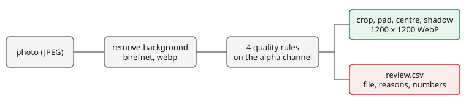

# Marketplace photos to catalogue images

English | [简体中文](README.zh-CN.md)

Cut the product out of each marketplace photo with `birefnet`, check the cut-out with four local rules, compose the ones that pass into 1200 x 1200 white-background WebP catalogue images with a soft shadow, and list the rest, with the reason, for a person to look at.

## Problem <!-- #problem -->

Sellers upload photos with whatever background they have. A catalogue wants one look: the product centred on white, the same size and padding, a quiet shadow. Cutting out a background is easy to automate; knowing when the cut-out is *wrong* is the part that decides whether the pipeline can run unattended. A cut that lost half the product, swallowed the table, or kept two products must not reach the catalogue silently.

## Pipeline <!-- #pipeline -->

<!-- figure: assets/pipeline.svg -->


1. `POST /v1/remove-background` with `model: birefnet`, `options: {output: "cutout", format: "webp"}`. The WebP cut-out is about ten times smaller than the PNG. One credit per image; the cache gives no discount.
2. Four rules on the alpha channel (next section).
3. A cut-out that passes is cropped to its alpha bounding box, scaled to fit inside a 10 percent padding, centred on a white 1200 x 1200 canvas with a soft drop shadow, and saved as WebP.
4. A cut-out that fails is written to `review.csv` with the file, the reasons and the measured numbers.

## Run it <!-- #run -->

```bash
export FOLDBUN_API_KEY=...            # a billed account: remove-background is a paid model
cd use-cases/06-product-photo-pipeline/python
uv run python main.py --manifest ../assets/smoke/manifest.json --out out --concurrency 4
```

`--resume` reuses the cut-outs already in `out/cutouts/` instead of paying again. Exit codes: 0 done (items may be in `review.csv`), 1 failed, 2 no key, 3 the account cannot use the model, 4 the credit cap (`FOLDBUN_MAX_CREDITS`) refused a call. The full set (40 photos, 40 credits) is a release asset, see `assets/full.json`. Score a run with `uv run python evaluate.py --result out/result.json --truth assets/truth.json`.

## Code <!-- #code -->

### Quality rules

Every threshold is a named constant. They were set on the 40 photos of the full set; the Results section shows how many of them the rules stop.

- **Coverage** (`MIN_COVERAGE` 5 percent, `MAX_COVERAGE` 90 percent of the frame at alpha of at least 128): below means the model found nothing, above means it kept the background.
- **Edge cut** (`EDGE_BAND` the outer 1 percent of the frame, `EDGE_TOUCH_MAX` 3 percent of a side): a product that touches the frame is cut off by the photo, and no cut-out can restore the rest.
- **Semi-transparent share** (`MAX_SEMI_SHARE` 10 percent of the non-background pixels have alpha between 16 and 240): a wide soft boundary means the model was unsure, typical for glass and reflections.
- **Pieces** (`MIN_COMPONENT_SHARE` 2 percent of the foreground; counted on a copy scaled to 256 px): more than one piece usually means more than one product, or a product split in two.

<!-- code: thresholds -->
<details><summary>Python (python/pipeline.py)</summary>

```python
# Quality rules. Every number is a named constant so a catalogue team can tune it. They were set on the 40 photos of the
# full set; expected/full-summary.json records how many of them the rules stop.
FOREGROUND_ALPHA = 128  # alpha at or above this is "the product" (half opaque)
SEMI_LOW, SEMI_HIGH = 16, 240  # alpha strictly between these is "semi-transparent" (neither background nor solid)
MIN_COVERAGE, MAX_COVERAGE = 0.05, 0.90  # share of the frame the product fills: outside means a missed or a swallowed subject
EDGE_BAND = 0.01  # the outer 1 percent of each side (at least 2 px) is the frame edge ...
EDGE_TOUCH_MAX = 0.03  # ... and the product may cover at most 3 percent of that side before it counts as cut off by the frame
MAX_SEMI_SHARE = 0.10  # semi-transparent pixels as a share of all non-background pixels: above this the boundary is uncertain
MIN_COMPONENT_SHARE = 0.02  # a connected piece smaller than 2 percent of the foreground is a speck, not a second product
COMPONENT_SIDE = 256  # connected pieces are counted on a copy scaled down to this long side (specks vanish, cost is bounded)
```

</details>
<!-- /code -->

<!-- code: quality -->
<details><summary>Python (python/pipeline.py)</summary>

```python
def coverage_and_semi(alpha: Image.Image) -> tuple[float, float]:
    """Foreground share of the frame, and semi-transparent share of everything that is not background (one histogram)."""
    hist = alpha.histogram()
    total = alpha.width * alpha.height
    foreground = sum(hist[FOREGROUND_ALPHA:])
    semi = sum(hist[SEMI_LOW + 1 : SEMI_HIGH])
    visible = sum(hist[SEMI_LOW + 1 :])
    return foreground / total, (semi / visible if visible else 0.0)


def edge_touch(alpha: Image.Image) -> float:
    """The largest share of one frame side that the foreground covers, looking at the outer EDGE_BAND of the frame."""
    w, h = alpha.size
    binary = alpha.point(lambda a: 255 if a >= FOREGROUND_ALPHA else 0)
    bx, by = max(2, round(w * EDGE_BAND)), max(2, round(h * EDGE_BAND))
    bands = [
        (binary.crop((0, 0, w, by)), (w, 1)),
        (binary.crop((0, h - by, w, h)), (w, 1)),
        (binary.crop((0, 0, bx, h)), (1, h)),
        (binary.crop((w - bx, 0, w, h)), (1, h)),
    ]
    shares = []
    for band, size in bands:
        line = band.resize(size, Image.BOX)  # a pixel is lit when any pixel of its row or column in the band is foreground
        shares.append(sum(1 for v in line.tobytes() if v) / (size[0] * size[1]))
    return max(shares)


def count_pieces(alpha: Image.Image) -> int:
    """Connected pieces (8-neighbourhood) of the foreground, ignoring specks below MIN_COMPONENT_SHARE of the foreground."""
    scale = COMPONENT_SIDE / max(alpha.size)
    small = alpha.resize((max(1, round(alpha.width * scale)), max(1, round(alpha.height * scale))), Image.BOX) if scale < 1 else alpha
    w, h = small.size
    fg = bytearray(1 if v >= FOREGROUND_ALPHA else 0 for v in small.tobytes())
    sizes = []
    for start in range(w * h):
        if not fg[start]:
            continue
        fg[start], stack, n = 0, [start], 0
        while stack:
            p = stack.pop()
            n += 1
            x, y = p % w, p // w
            for ny in range(max(0, y - 1), min(h, y + 2)):
                for nx in range(max(0, x - 1), min(w, x + 2)):
                    q = ny * w + nx
                    if fg[q]:
                        fg[q] = 0
                        stack.append(q)
        sizes.append(n)
    total = sum(sizes)
    return sum(1 for n in sizes if n >= MIN_COMPONENT_SHARE * total)


def assess(alpha: Image.Image) -> Quality:
    """Apply the four rules to an 8-bit alpha channel. `reasons` is empty when the cut-out may go into the catalogue."""
    coverage, semi = coverage_and_semi(alpha)
    touch = edge_touch(alpha)
    pieces = count_pieces(alpha)
    reasons = []
    if coverage < MIN_COVERAGE:
        reasons.append("coverage_low")
    if coverage > MAX_COVERAGE:
        reasons.append("coverage_high")
    if touch > EDGE_TOUCH_MAX:
        reasons.append("edge_cut")
    if semi > MAX_SEMI_SHARE:
        reasons.append("semi_transparent")
    if pieces > 1:
        reasons.append("multiple_pieces")
    return Quality(coverage, touch, semi, pieces, reasons)
```

</details>
<!-- /code -->

<!-- code: fetch-cutout -->
<details><summary>Python (python/main.py)</summary>

```python
def fetch_cutout(client: sc.StackClient, image_path: Path, item_id: str, out: Path, resume: bool) -> tuple[bytes, list[dict]]:
    """The WebP cut-out of one photo and the ledger rows of the call (none when it is read back from an earlier run)."""
    cached, state = out / "cutouts" / f"{item_id}.webp", out / "state" / f"{item_id}.json"
    if resume and cached.exists() and state.exists():
        return cached.read_bytes(), json.loads(state.read_text())["calls"]
    body = {"model": "birefnet", "image": sc.image_base64(image_path.read_bytes()), "options": {"output": "cutout", "format": "webp"}}
    result = client.post("/v1/remove-background", body, tag=item_id)  # retries, pacing and the credit cap live in the client
    data = base64.b64decode(result["data"])
    cached.parent.mkdir(parents=True, exist_ok=True)
    state.parent.mkdir(parents=True, exist_ok=True)
    cached.write_bytes(data)
    calls = client.calls(item_id)
    state.write_text(json.dumps({"calls": calls}))
    return data, calls
```

</details>
<!-- /code -->

<!-- code: compose -->
<details><summary>Python (python/pipeline.py)</summary>

```python
def compose(cutout: Image.Image) -> Image.Image:
    """Crop to the alpha bounding box, fit inside the padded canvas, centre on white and add a soft shadow."""
    box = cutout.getchannel("A").point(lambda a: 255 if a > SEMI_LOW else 0).getbbox()
    if box is None:
        raise ValueError("the cut-out is empty")
    product = cutout.crop(box)
    inner = round(CANVAS * (1 - 2 * PADDING))
    scale = inner / max(product.size)
    product = product.resize((max(1, round(product.width * scale)), max(1, round(product.height * scale))), Image.LANCZOS)
    x, y = (CANVAS - product.width) // 2, (CANVAS - product.height) // 2
    shadow = Image.new("L", (CANVAS, CANVAS), 0)
    shadow.paste(product.getchannel("A").point(lambda a: round(a * SHADOW_OPACITY)), (x, y + round(CANVAS * SHADOW_OFFSET)))
    shadow = shadow.filter(ImageFilter.GaussianBlur(CANVAS * SHADOW_BLUR))
    page = Image.new("RGB", (CANVAS, CANVAS), "white")
    page.paste(Image.new("RGB", (CANVAS, CANVAS), "black"), (0, 0), shadow)
    page.paste(product, (x, y), product)
    return page


def encode_webp(page: Image.Image) -> bytes:
    out = io.BytesIO()
    page.save(out, "WEBP", quality=WEBP_QUALITY)
    return out.getvalue()
```

</details>
<!-- /code -->

## Results <!-- #results -->

`evaluate.py` scores a run on the 40 photos against the Open Images instance masks: the IoU of the cut-out alpha (at 128) with the ground truth (mean and 10th percentile), the share of photos the rules stop, and a confusion matrix of "stopped" against "IoU below 0.85", which says whether the rules catch the cut-outs that are wrong. A run records no timing: the numbers would depend on the network path, so none is published.

<!-- metrics: expected/full-summary.json -->
| Metric | Value |
|---|---|
| `photos` | 40 |
| `iou_mean` | 0.8812 |
| `iou_p10` | 0.6377 |
| `review_rate` | 0.25 |
| `wrong_cutouts` | 9 |
| `confusion.stopped_wrong` | 4 |
| `confusion.stopped_fine` | 6 |
| `confusion.passed_wrong` | 5 |
| `confusion.passed_fine` | 25 |
| `rules_precision` | 0.4 |
| `rules_recall` | 0.4444 |
| `by_kind.normal.photos` | 28 |
| `by_kind.normal.stopped` | 2 |
| `by_kind.normal.wrong` | 6 |
| `by_kind.truncated.photos` | 4 |
| `by_kind.truncated.stopped` | 4 |
| `by_kind.truncated.wrong` | 2 |
| `by_kind.multi.photos` | 4 |
| `by_kind.multi.stopped` | 4 |
| `by_kind.multi.wrong` | 1 |
| `by_kind.thin.photos` | 4 |
| `by_kind.thin.stopped` | 0 |
| `by_kind.thin.wrong` | 0 |
| `hard_cases_stopped_rate` | 1 |
| `other_photos_stopped_rate` | 0.0625 |
| `cost_per_1000_images_list` | 1,000 |
<!-- /metrics -->

How to read the recorded run:

- The rules stopped all 8 hard cases by design (4 cut off by the frame, 4 with several products) and 2 of the other 32 photos. None of the 4 products with thin structures was stopped, and none of those cut-outs was wrong.
- The confusion matrix is harsher than the catalogue would be. An Open Images mask covers the labelled object only, so a cut-out that keeps the saucer under a cup, or both of two stacked toys, has a low IoU although it is what a catalogue wants; 3 of the 5 "passed but wrong" cut-outs are of this kind. The other 2 are real misses: a cut-out that kept a strip of background, and one broken up by a reflection. The rules do not see either; a low IoU needs ground truth, which a production run does not have.
- 6 of the 10 stopped cut-outs have a good IoU. 4 of them are the photos with several products, where the cut-out is right and the photo is not a catalogue image; that is what the `multiple_pieces` rule is for.

## Cost <!-- #cost -->

One credit per image (US$0.001 at 1,000 credits per US$1), so 1,000 photos cost 1,000 credits. The cache does not discount this endpoint, and the quality rules and the composition run locally for free. A rerun pays again unless you use `--resume`.

<!-- cost -->
| Run | Calls | List price (credits) | Charged (credits) |
|---|---|---|---|
| smoke | 3 | 3 | 3 |
| full | 40 | 40 | 40 |
<!-- /cost -->

## Limits and when not to use this <!-- #limits -->

- A photo with several products is cut out as a whole. The `multiple_pieces` rule sends it to review; when you want only one of them, choose the object first with `sam3` and a text prompt and cut out that region. That combination is not implemented here.
- Transparent and reflective products (glass, polished metal) get unstable edges. Expect them in `review.csv`.
- A product cut off by the frame cannot be repaired. The rule only detects it.
- One credit per photo, with no cache discount: a large backlog is a real bill.
- The thresholds were set on 40 photos of household objects; check them against your own catalogue.

## Data <!-- #data -->

40 Open Images V7 validation photos (CC BY 2.0, per-file attribution in `assets/ATTRIBUTION.csv`) of cups, bowls, bottles, cameras, toys, guitars, furniture and appliances, with instance masks (CC BY 4.0) as ground truth: 28 plain centred products and 12 hard cases (4 cut off by the frame, 4 with several products, 4 with thin structures). Photos with people, faces, plates, watermarks or large brand lettering were removed by hand. Where an image shows several instances, the ground truth is the union of their masks. The smoke set is 3 of the 40.
