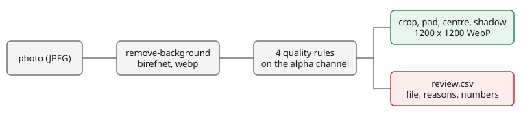

<!-- en-sha: 351a3a803548 -->
# 把商家照片变成统一的商品目录图

[English](README.md) | 简体中文

用 `birefnet` 把商品从每张商家照片里抠出来，在本地用四条规则检查抠图；通过的合成为 1200 x 1200 的白底 WebP 目录图（带柔和投影），不通过的连同原因列出来交给人看。

## 问题 <!-- #problem -->

商家上传的照片背景各不相同，而目录要的是统一的样子：商品居中、白底、尺寸和留白一致、投影柔和。抠背景很容易自动化；难的是知道抠图什么时候是错的，这决定了流程能否无人值守。丢了半个商品、把桌面一起抠进来、或留下两件商品的抠图，不能悄悄进入目录。

## 流程 <!-- #pipeline -->

<!-- figure: assets/pipeline.svg -->


1. `POST /v1/remove-background`，`model: birefnet`，`options: {output: "cutout", format: "webp"}`。WebP 抠图比 PNG 小约 10 倍。每张 1 credit，缓存不打折。
2. 对 alpha 通道做四条规则检查（见下一节）。
3. 通过的抠图按 alpha 外接框裁剪，缩放到留出 10% 边距的范围内，居中放在 1200 x 1200 的白底上，加柔和投影，存为 WebP。
4. 不通过的写入 `review.csv`，附文件、原因和测得的数值。

## 运行 <!-- #run -->

```bash
export FOLDBUN_API_KEY=...            # 付费账户：remove-background 是付费模型
cd use-cases/06-product-photo-pipeline/python
uv run python main.py --manifest ../assets/smoke/manifest.json --out out --concurrency 4
```

`--resume` 复用 `out/cutouts/` 里已有的抠图，不重复付费。退出码：0 完成（部分条目可能在 `review.csv` 里），1 失败，2 没有密钥，3 账户不能用该模型，4 额度上限（`FOLDBUN_MAX_CREDITS`）拒绝了调用。完整集（40 张，40 credits）是发布资产，见 `assets/full.json`。用 `uv run python evaluate.py --result out/result.json --truth assets/truth.json` 给一次运行打分。

## 代码 <!-- #code -->

### 质检规则

每个阈值都是具名常量，在完整集的 40 张照片上定下；规则拦下了其中多少张见「实测」一节。

- **覆盖率**（`MIN_COVERAGE` 5%、`MAX_COVERAGE` 90%，按 alpha 不低于 128 的像素占画面的比例）：过低说明模型什么都没找到，过高说明把背景也留下了。
- **贴边**（`EDGE_BAND` 取画面外缘 1%，`EDGE_TOUCH_MAX` 为一条边的 3%）：商品碰到画面边缘就是被照片截断了，抠图无法恢复缺掉的部分。
- **半透明占比**（`MAX_SEMI_SHARE`：非背景像素中 alpha 在 16 到 240 之间的占 10%）：边界又宽又软说明模型拿不准，常见于玻璃和反光。
- **连通块数**（`MIN_COMPONENT_SHARE`：小于前景 2% 的块算杂点；在缩到 256 px 的副本上计数）：多于一块通常意味着多件商品，或商品被切成两半。

<!-- code: thresholds -->
<details><summary>Python (python/pipeline.py)</summary>

```python
# Quality rules. Every number is a named constant so a catalogue team can tune it. They were set on the 40 photos of the
# full set; expected/full-summary.json records how many of them the rules stop.
FOREGROUND_ALPHA = 128  # alpha at or above this is "the product" (half opaque)
SEMI_LOW, SEMI_HIGH = 16, 240  # alpha strictly between these is "semi-transparent" (neither background nor solid)
MIN_COVERAGE, MAX_COVERAGE = 0.05, 0.90  # share of the frame the product fills: outside means a missed or a swallowed subject
EDGE_BAND = 0.01  # the outer 1 percent of each side (at least 2 px) is the frame edge ...
EDGE_TOUCH_MAX = 0.03  # ... and the product may cover at most 3 percent of that side before it counts as cut off by the frame
MAX_SEMI_SHARE = 0.10  # semi-transparent pixels as a share of all non-background pixels: above this the boundary is uncertain
MIN_COMPONENT_SHARE = 0.02  # a connected piece smaller than 2 percent of the foreground is a speck, not a second product
COMPONENT_SIDE = 256  # connected pieces are counted on a copy scaled down to this long side (specks vanish, cost is bounded)
```

</details>
<!-- /code -->

<!-- code: quality -->
<details><summary>Python (python/pipeline.py)</summary>

```python
def coverage_and_semi(alpha: Image.Image) -> tuple[float, float]:
    """Foreground share of the frame, and semi-transparent share of everything that is not background (one histogram)."""
    hist = alpha.histogram()
    total = alpha.width * alpha.height
    foreground = sum(hist[FOREGROUND_ALPHA:])
    semi = sum(hist[SEMI_LOW + 1 : SEMI_HIGH])
    visible = sum(hist[SEMI_LOW + 1 :])
    return foreground / total, (semi / visible if visible else 0.0)


def edge_touch(alpha: Image.Image) -> float:
    """The largest share of one frame side that the foreground covers, looking at the outer EDGE_BAND of the frame."""
    w, h = alpha.size
    binary = alpha.point(lambda a: 255 if a >= FOREGROUND_ALPHA else 0)
    bx, by = max(2, round(w * EDGE_BAND)), max(2, round(h * EDGE_BAND))
    bands = [
        (binary.crop((0, 0, w, by)), (w, 1)),
        (binary.crop((0, h - by, w, h)), (w, 1)),
        (binary.crop((0, 0, bx, h)), (1, h)),
        (binary.crop((w - bx, 0, w, h)), (1, h)),
    ]
    shares = []
    for band, size in bands:
        line = band.resize(size, Image.BOX)  # a pixel is lit when any pixel of its row or column in the band is foreground
        shares.append(sum(1 for v in line.tobytes() if v) / (size[0] * size[1]))
    return max(shares)


def count_pieces(alpha: Image.Image) -> int:
    """Connected pieces (8-neighbourhood) of the foreground, ignoring specks below MIN_COMPONENT_SHARE of the foreground."""
    scale = COMPONENT_SIDE / max(alpha.size)
    small = alpha.resize((max(1, round(alpha.width * scale)), max(1, round(alpha.height * scale))), Image.BOX) if scale < 1 else alpha
    w, h = small.size
    fg = bytearray(1 if v >= FOREGROUND_ALPHA else 0 for v in small.tobytes())
    sizes = []
    for start in range(w * h):
        if not fg[start]:
            continue
        fg[start], stack, n = 0, [start], 0
        while stack:
            p = stack.pop()
            n += 1
            x, y = p % w, p // w
            for ny in range(max(0, y - 1), min(h, y + 2)):
                for nx in range(max(0, x - 1), min(w, x + 2)):
                    q = ny * w + nx
                    if fg[q]:
                        fg[q] = 0
                        stack.append(q)
        sizes.append(n)
    total = sum(sizes)
    return sum(1 for n in sizes if n >= MIN_COMPONENT_SHARE * total)


def assess(alpha: Image.Image) -> Quality:
    """Apply the four rules to an 8-bit alpha channel. `reasons` is empty when the cut-out may go into the catalogue."""
    coverage, semi = coverage_and_semi(alpha)
    touch = edge_touch(alpha)
    pieces = count_pieces(alpha)
    reasons = []
    if coverage < MIN_COVERAGE:
        reasons.append("coverage_low")
    if coverage > MAX_COVERAGE:
        reasons.append("coverage_high")
    if touch > EDGE_TOUCH_MAX:
        reasons.append("edge_cut")
    if semi > MAX_SEMI_SHARE:
        reasons.append("semi_transparent")
    if pieces > 1:
        reasons.append("multiple_pieces")
    return Quality(coverage, touch, semi, pieces, reasons)
```

</details>
<!-- /code -->

<!-- code: fetch-cutout -->
<details><summary>Python (python/main.py)</summary>

```python
def fetch_cutout(client: sc.StackClient, image_path: Path, item_id: str, out: Path, resume: bool) -> tuple[bytes, list[dict]]:
    """The WebP cut-out of one photo and the ledger rows of the call (none when it is read back from an earlier run)."""
    cached, state = out / "cutouts" / f"{item_id}.webp", out / "state" / f"{item_id}.json"
    if resume and cached.exists() and state.exists():
        return cached.read_bytes(), json.loads(state.read_text())["calls"]
    body = {"model": "birefnet", "image": sc.image_base64(image_path.read_bytes()), "options": {"output": "cutout", "format": "webp"}}
    result = client.post("/v1/remove-background", body, tag=item_id)  # retries, pacing and the credit cap live in the client
    data = base64.b64decode(result["data"])
    cached.parent.mkdir(parents=True, exist_ok=True)
    state.parent.mkdir(parents=True, exist_ok=True)
    cached.write_bytes(data)
    calls = client.calls(item_id)
    state.write_text(json.dumps({"calls": calls}))
    return data, calls
```

</details>
<!-- /code -->

<!-- code: compose -->
<details><summary>Python (python/pipeline.py)</summary>

```python
def compose(cutout: Image.Image) -> Image.Image:
    """Crop to the alpha bounding box, fit inside the padded canvas, centre on white and add a soft shadow."""
    box = cutout.getchannel("A").point(lambda a: 255 if a > SEMI_LOW else 0).getbbox()
    if box is None:
        raise ValueError("the cut-out is empty")
    product = cutout.crop(box)
    inner = round(CANVAS * (1 - 2 * PADDING))
    scale = inner / max(product.size)
    product = product.resize((max(1, round(product.width * scale)), max(1, round(product.height * scale))), Image.LANCZOS)
    x, y = (CANVAS - product.width) // 2, (CANVAS - product.height) // 2
    shadow = Image.new("L", (CANVAS, CANVAS), 0)
    shadow.paste(product.getchannel("A").point(lambda a: round(a * SHADOW_OPACITY)), (x, y + round(CANVAS * SHADOW_OFFSET)))
    shadow = shadow.filter(ImageFilter.GaussianBlur(CANVAS * SHADOW_BLUR))
    page = Image.new("RGB", (CANVAS, CANVAS), "white")
    page.paste(Image.new("RGB", (CANVAS, CANVAS), "black"), (0, 0), shadow)
    page.paste(product, (x, y), product)
    return page


def encode_webp(page: Image.Image) -> bytes:
    out = io.BytesIO()
    page.save(out, "WEBP", quality=WEBP_QUALITY)
    return out.getvalue()
```

</details>
<!-- /code -->

## 实测 <!-- #results -->

`evaluate.py` 在 40 张照片上对照 Open Images 的实例掩码打分：抠图 alpha（按 128 二值化）与真值的 IoU（均值和 P10）、质检拦下的比例，以及「被拦截」对「IoU 低于 0.85」的混淆矩阵，用来说明规则能否抓住真正有问题的抠图。运行不记录耗时：数字取决于客户端的网络路径，所以不发布。

<!-- metrics: expected/full-summary.json -->
| 指标 | 数值 |
|---|---|
| `photos` | 40 |
| `iou_mean` | 0.8812 |
| `iou_p10` | 0.6377 |
| `review_rate` | 0.25 |
| `wrong_cutouts` | 9 |
| `confusion.stopped_wrong` | 4 |
| `confusion.stopped_fine` | 6 |
| `confusion.passed_wrong` | 5 |
| `confusion.passed_fine` | 25 |
| `rules_precision` | 0.4 |
| `rules_recall` | 0.4444 |
| `by_kind.normal.photos` | 28 |
| `by_kind.normal.stopped` | 2 |
| `by_kind.normal.wrong` | 6 |
| `by_kind.truncated.photos` | 4 |
| `by_kind.truncated.stopped` | 4 |
| `by_kind.truncated.wrong` | 2 |
| `by_kind.multi.photos` | 4 |
| `by_kind.multi.stopped` | 4 |
| `by_kind.multi.wrong` | 1 |
| `by_kind.thin.photos` | 4 |
| `by_kind.thin.stopped` | 0 |
| `by_kind.thin.wrong` | 0 |
| `hard_cases_stopped_rate` | 1 |
| `other_photos_stopped_rate` | 0.0625 |
| `cost_per_1000_images_list` | 1,000 |
<!-- /metrics -->

怎么读这次录制的结果：

- 8 张按设计属于难例的照片（4 张被画面截断、4 张含多件商品）全部被规则拦下；其余 32 张里拦下 2 张。4 张带细长结构的商品一张也没被拦，抠图也都没有问题。
- 混淆矩阵比实际的目录要求更严。Open Images 的掩码只覆盖被标注的那个物体，所以把杯子下面的碟子一起留下、或把叠在一起的两个玩具都留下的抠图 IoU 偏低，但这正是目录想要的结果；5 张「放行但有问题」里有 3 张属于这种情况。另外 2 张是真的漏检：一张带进了一条背景，一张被反光切碎。这两种规则都看不出来；IoU 低要有真值才能知道，而生产运行没有真值。
- 被拦下的 10 张里有 6 张 IoU 是好的。其中 4 张是含多件商品的照片：抠图没错，但照片本身不是一张目录图，`multiple_pieces` 规则就是为此而设。

## 成本 <!-- #cost -->

每张 1 credit（1,000 credits 折合 1 美元，即每张 0.001 美元），1,000 张是 1,000 credits。这个端点缓存不打折；质检和合成都在本地运行，不花钱。重跑会再次付费，除非用 `--resume`。

<!-- cost -->
| 运行 | 调用次数 | 标价（credits） | 实扣（credits） |
|---|---|---|---|
| smoke | 3 | 3 | 3 |
| full | 40 | 40 | 40 |
<!-- /cost -->

## 局限与不适用的场景 <!-- #limits -->

- 一张照片里有多件商品时只能整体抠出。`multiple_pieces` 规则会把它送去复核；只要其中一件时，先用 `sam3` 加文字提示选出物体再抠。这个组合这里没有实现。
- 透明和反光的商品（玻璃、抛光金属）边缘不稳定，预期会出现在 `review.csv` 里。
- 被画面截断的商品无法修复，规则只负责发现。
- 每张 1 credit，缓存不打折：积压量大时是一笔实打实的费用。
- 阈值只在 40 张家居物品照片上定过；用你自己的目录再核对一遍。

## 数据 <!-- #data -->

40 张 Open Images V7 验证集照片（CC BY 2.0，逐文件署名见 `assets/ATTRIBUTION.csv`），内容是杯子、碗、瓶子、相机、玩具、吉他、家具和家电，以 CC BY 4.0 的实例掩码为真值：28 张居中的普通商品，12 张难例（4 张被画面截断、4 张多件商品、4 张带细结构）。含人物、人脸、车牌、水印或大幅品牌字样的照片已人工剔除。一张图有多个实例时，真值取它们掩码的并集。冒烟集是这 40 张里的 3 张。
