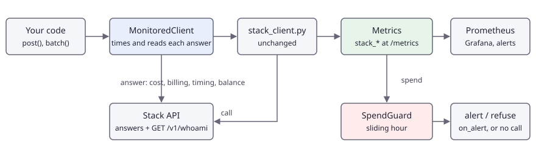

# Monitor cost and latency of a production integration

English | [简体中文](README.zh-CN.md)

Wrap the client file in a monitoring layer that turns the billing and timing of every answer into Prometheus metrics (credits by model and unit, calls by outcome, encoding-cache hits and what they saved, queue and processing time, balance and daily allowances) and trips a spend guard before the budget is gone. Nothing is asked of the API except an optional, free `GET /v1/whoami`.

## Problem <!-- #problem -->

An integration that works on the day it ships can still go wrong in production without a single error: a loop that re-sends the same image, a prompt that grows from one to ten per call, a batch job that doubles in size, or a model whose queue time creeps up when everyone else is busy. The API tells you everything you need on each answer, but only for that one call. What you want is a few numbers over time and someone told when they move:

- how many credits per hour, by model and by unit (`image`, `prompt`, `encode_image`, ...), and how much of it was really debited rather than covered by an included daily allowance;
- how often a SAM call reuses an image that was already encoded (the encoding fee is waived on a cache hit), and what that saved;
- how long calls wait in the queue and how long they are processed, as the server measured them;
- what is left on the account, and an alert before it is gone, or a refusal to send more calls when the spend of the last hour is out of line.

This example is that layer for Python: one file, `monitoring.py`, that you copy next to `stack_client.py`. It does not modify the client file. It wraps a client object, reads each answer (`cost`, `billing`, `cache`, `timing`, `balance`, the error code) and, for batches, each `item` event. A replay of 21 calls (`assets/workload.jsonl`) exercises it end to end and checks that the metrics and the client's own ledger agree.

## Pipeline <!-- #pipeline -->

<!-- figure: assets/pipeline.svg -->


| Step | What happens | Endpoint |
|---|---|---|
| Wrap | `MonitoredClient(StackClient(), Monitor(guard=...))`: `post` and `batch` are measured, everything else is forwarded | none |
| Call | the wrapped client sends the call as usual: retries, throttling, idempotency and the credit cap are the client's | `POST /v1/ocr`, `/v1/segment`, ..., `POST /v1/batch/*` |
| Read | credits per `billing.lines[]`, `cost`, `cache`, `timing.queueMs` / `processingMs`, `balance`, the allowance of the pool; an error is counted by its `code` | none |
| Guard | the spend of the last hour is compared with the limit; alert once per crossing, or refuse new calls | none |
| Refresh | `refresh_account()` reads the balance and today's daily allowances; call it on a timer, `refresh_every(client, 60)` does | `GET /v1/whoami` (free, not metered) |
| Expose | `monitor.serve(9108)` serves `GET /metrics`; Prometheus scrapes it, Grafana and alert rules read it | none |

The metrics, all prefixed `stack_`:

| Metric | Labels | Source |
|---|---|---|
| `stack_credits_total` | `model`, `unit`, `charged` | every priced line of `billing.lines[]`; `charged="false"` is list price of work covered by an included daily allowance |
| `stack_calls_total` | `model`, `status`, `code` | `status` is `ok`, `replayed`, `error`, `expired` or `refused` (never sent: credit cap or guard); `code` is the API error code, `none` for `ok` |
| `stack_cache_hits_total`, `stack_cache_misses_total` | `model` | `cache` of SAM answers |
| `stack_cache_saved_credits_total` | `model` | list price of the lines with `waived: true` |
| `stack_latency_ms` (histogram) | `model`, `phase` | `queue` and `processing` from `timing`; `client_total` is the time this process measured around the call, for your own dashboards |
| `stack_balance_credits`, `stack_balance_updated_timestamp_seconds` | | `balance` of the last answer or `whoami` refresh, and when |
| `stack_daily_allowance_used`, `stack_daily_allowance_limit` | `pool` | `billing.allowance` of answers and `whoami` |
| `stack_spend_window_credits`, `stack_spend_guard_tripped` | | the guard's window, and whether it is over the limit |

## Run it <!-- #run -->

```bash
export FOLDBUN_API_KEY="fbs_..."          # a funded account: sam-lite needs one
export FOLDBUN_MAX_CREDITS=2.75           # the client refuses calls that could pass it
cd use-cases/08-cost-and-latency-monitoring/python
uv run main.py --out out --hold 30        # 21 calls; /metrics on :9108 while it runs and 30 s after
curl -s localhost:9108/metrics | grep '^stack_'                          # from a second terminal
uv run main.py --out out --guard-mode reject --guard-max 0.2            # the guard refuses calls once the last hour is over 0.2 credits
uv run python ../evaluate.py --result out/result.json --overhead        # check the books, print the cost of the layer
```

Arguments: `--manifest`, `--out`, `--concurrency` (default 1: with one call at a time, the call that trips the guard has a stable number), `--limit`, `--resume` (accepted; a replay always starts over), `--metrics-port` (default 9108, 0 to not serve), `--hold`, `--guard-max` (credits per hour, default 0.2), `--guard-mode` (`alert` or `reject`), `--guard-basis` (`charged` or `list`). Outputs: `result.json` (format of `contract/result.schema.json`: one item per call and a last item `summary` with what the layer counted) and `metrics.prom`, the text exposition at the end of the run.

Without a key, run the same replay against the local fake of the API (see `CONTRIBUTING.md`); `uv run python -m harness check --uc 08` does that.

A new account cannot run it: `sam-lite` and `sam3` answer `403 model_locked`, and the replay stops with exit code 3.

To wire it into your own service, copy `monitoring.py` and use it like this:

```python
from stack_client import StackClient
from monitoring import Monitor, MonitoredClient, SpendGuard

guard = SpendGuard(max_per_hour=50, mode="alert", on_alert=notify)   # notify(info) gets the call number, the spend and the limit
monitor = Monitor(guard=guard)
client = MonitoredClient(StackClient(), monitor)                     # use it where you used StackClient
monitor.serve(9108)                                                  # or mount monitor.exposition() in your own web app
monitor.refresh_every(client, 60)                                    # balance and allowances, every minute
```

Alerting rules and a Grafana dashboard for these metrics are in `assets/alerts.rules.yml` and `assets/grafana-dashboard.json` (import the dashboard, pick your Prometheus data source). `assets/metrics.sample.prom` is the exposition of one replay against the local fake API.

## Code <!-- #code -->

The wrapper. `post` and `batch` are measured; every other attribute (`upload`, `models`, `get`, `calls`, `summary`) is the wrapped client's.

<!-- code: wrapper -->
<details><summary>Python (python/monitoring.py)</summary>

```python
class MonitoredClient:
    """Wraps a StackClient. `post` and `batch` are measured; every other attribute (`upload`, `models`, `get`, `calls`,
    `summary`, `ledger`, ...) is the wrapped client's."""

    def __init__(self, client, monitor):
        self._client, self.monitor = client, monitor

    def __getattr__(self, name):
        return getattr(self._client, name)

    @staticmethod
    def _model(path, body):
        return body.get("model") or sc.DEFAULT_MODEL.get(path) or "unknown"

    def _replayed(self, tag):
        """Whether the client's ledger says the answer of this call was a replay of a stored one."""
        ledger = getattr(self._client, "ledger", None) or []
        for t, row in reversed(ledger[-32:]):
            if t == tag:
                return bool(row.get("replayed"))
        return False

    def post(self, path, body, idempotency_key=None, *, tag=None, **kwargs):
        model = self._model(path, body)
        tag = tag or self.monitor.next_tag()
        try:
            if self.monitor.guard:
                self.monitor.guard.check()
        except SpendGuardTripped as err:
            self.monitor.failure(model, err)
            raise
        t0 = self.monitor.clock()
        try:
            result = self._client.post(path, body, idempotency_key, tag=tag, **kwargs)
        except Exception as err:  # a StackError, or anything unexpected: counted, then raised unchanged
            self.monitor.failure(model, err, client_ms=(self.monitor.clock() - t0) * 1000)
            raise
        self.monitor.observe(model, result, replayed=self._replayed(tag), client_ms=(self.monitor.clock() - t0) * 1000)
        return result

    def batch(self, endpoint, body, idempotency_key=None, *, tag=None):
        """Like StackClient.batch (yields (event, data)); every `item` event is counted with its own cost and timing."""
        model = self._model(f"/v1/{endpoint}", body)
        if self.monitor.guard:
            self.monitor.guard.check()
        try:
            for event, data in self._client.batch(endpoint, body, idempotency_key, tag=tag):
                if event == "item":
                    status = data.get("status")
                    if status == "ok":
                        self.monitor.observe(model, data["result"], replayed=bool(data.get("replayed")))
                    else:
                        error = data.get("error") or {}
                        self.monitor.failure(
                            model, sc.StackError(0, error.get("code") or status, error.get("message", "")), status="expired" if status == "expired" else "error"
                        )
                yield event, data
        except Exception as err:  # the stream itself failed (cut, timed out, refused)
            self.monitor.failure(model, err)
            raise

    def whoami(self):
        return self.monitor.refresh_account(self._client)
```

</details>
<!-- /code -->

What is read from one answer, and what becomes a metric:

<!-- code: observe -->
<details><summary>Python (python/monitoring.py)</summary>

```python
def observe(self, model, result, *, replayed=False, client_ms=None):
    """One successful call (or `ok` batch item): `result` is the answer body."""
    model = result.get("model") or model
    self.calls.labels(model, "replayed" if replayed else "ok", "none").inc()
    if client_ms is not None:
        self.latency.labels(model, "client_total").observe(client_ms)
    billing = result.get("billing") or {}
    cost = result.get("cost", 0)
    if not replayed:  # a replay returns the stored answer of a call that was already counted
        timing = result.get("timing") or {}
        for phase, key in (("queue", "queueMs"), ("processing", "processingMs")):
            if key in timing:
                self.latency.labels(model, phase).observe(timing[key])
        charged = "true" if billing.get("charged", cost > 0) else "false"
        for line in billing.get("lines") or [{"unit": "unknown", "amount": cost, "waived": False}]:
            if line.get("waived"):
                self.cache_saved.labels(model).inc(round(line["unitPrice"] * line["quantity"], 6))
            elif line["amount"]:
                self.credits.labels(model, line["unit"], charged).inc(line["amount"])
        if result.get("cache") == "hit":
            self.cache_hits.labels(model).inc()
        elif result.get("cache") == "miss":
            self.cache_misses.labels(model).inc()
        if "balance" in result:
            self._set_balance(result["balance"])
        if billing.get("pool") and billing.get("allowance"):
            self.allow_used.labels(billing["pool"]).set(billing["allowance"]["used"])
            self.allow_limit.labels(billing["pool"]).set(billing["allowance"]["limit"])
    by_list = self.guard is not None and self.guard.basis == "list"
    self._guard_record(0 if replayed else billing.get("total", cost) if by_list else cost)

def failure(self, model, error, *, status="error", client_ms=None):
    """One failed call: `error` is a StackError (or anything with `.code`). Local refusals count as "refused"."""
    code = getattr(error, "code", None) or type(error).__name__
    if getattr(error, "status", None) == 0 and code in ("budget_exceeded", "spend_guard_tripped"):
        status = "refused"
    self.calls.labels(model, status, code).inc()
    if client_ms is not None:
        self.latency.labels(model, "client_total").observe(client_ms)
    self._guard_record(0)

def _set_balance(self, value):
    self.balance.set(value)
    self.balance_at.set(self.wall())

def _guard_record(self, amount):
    if self.guard:
        self.guard.record(amount)
        self.window_spend.set(self.guard.spent())
        self.guard_tripped.set(1 if self.guard.tripped else 0)
```

</details>
<!-- /code -->

The spend guard: a sliding window, in integer micro-credits so that sums do not drift, with a clock you can replace in tests. `alert` calls back once per crossing and re-arms when the spend falls back under the limit; `reject` refuses new calls while it is over.

<!-- code: guard -->
<details><summary>Python (python/monitoring.py)</summary>

```python
class SpendGuard:
    """Sliding-window spend rate. `max_per_hour` credits over the last `window_s` seconds (default one hour).

    mode "alert":  `on_alert(info)` runs once each time the spend crosses the limit; calls are not stopped.
    mode "reject": `check()` raises SpendGuardTripped while the spend of the window is over the limit.
    basis "charged" counts what the account is debited (calls inside a daily allowance count 0); "list" counts the list price.
    Pure logic: pass `clock` (a function returning seconds) to test it without waiting."""

    def __init__(self, max_per_hour, *, mode="alert", basis="charged", on_alert=None, window_s=3600.0, clock=time.monotonic):
        if mode not in ("alert", "reject") or basis not in ("charged", "list"):
            raise ValueError('mode is "alert" or "reject"; basis is "charged" or "list"')
        self.max_per_hour, self.mode, self.basis, self.on_alert = max_per_hour, mode, basis, on_alert
        self.window_s, self.clock = window_s, clock
        self.records, self.alerts, self.tripped = 0, 0, False  # calls recorded, alerts raised, over the limit right now
        self._events, self._micro, self._lock = collections.deque(), 0, threading.Lock()

    def _expire(self, now):
        while self._events and self._events[0][0] <= now - self.window_s:
            self._micro -= self._events.popleft()[1]

    def spent(self):
        """Credits spent inside the window now."""
        with self._lock:
            self._expire(self.clock())
            return self._micro / 1e6

    def check(self):
        """Call before sending: in mode "reject", raises SpendGuardTripped while the window's spend is over the limit."""
        if self.mode != "reject":
            return
        with self._lock:
            self._expire(self.clock())
            over, spent = self._micro > self.max_per_hour * 1e6, self._micro / 1e6
        if over:
            raise SpendGuardTripped(
                f"call refused: {spent:g} credits in the last {self.window_s / 60:g} minutes pass the limit of {self.max_per_hour:g} credits"
            )

    def record(self, amount):
        """Add the spend of one finished call (0 is fine; it still counts as a call). Returns True when this call tripped the guard."""
        with self._lock:
            now = self.clock()
            self._expire(now)
            micro = round(amount * 1e6)
            self._events.append((now, micro))
            self._micro += micro
            self.records += 1
            over = self._micro > self.max_per_hour * 1e6
            fired = over and not self.tripped
            self.tripped = over
            info = {
                "call": self.records,
                "spent": self._micro / 1e6,
                "max_per_hour": self.max_per_hour,
                "window_s": self.window_s,
                "mode": self.mode,
                "basis": self.basis,
            }
            if fired:
                self.alerts += 1
        if fired and self.on_alert:
            self.on_alert(info)
        return fired
```

</details>
<!-- /code -->

Balance and daily allowances from `GET /v1/whoami`, on demand or on a timer:

<!-- code: account -->
<details><summary>Python (python/monitoring.py)</summary>

```python
def refresh_account(self, client):
    """GET /v1/whoami (free, not metered, no rate-limit token): balance and today's daily allowances."""
    info = client.get("/v1/whoami")
    self._set_balance(info["balance"])
    for a in info.get("dailyAllowances", []):
        self.allow_used.labels(a["pool"]).set(a["used"])
        self.allow_limit.labels(a["pool"]).set(a["limit"])
    return info

def refresh_every(self, client, seconds):
    """Refresh in a background thread; `.set()` the returned event to stop it. Errors are swallowed: the gauges just go stale."""
    stop = threading.Event()

    def loop():
        while not stop.wait(seconds):
            try:
                self.refresh_account(client)
            except Exception:  # noqa: BLE001
                pass

    threading.Thread(target=loop, daemon=True, name="stack-whoami").start()
    return stop
```

</details>
<!-- /code -->

The replay wires the layer around the client and keeps going when one call fails (failures are data, not a crash); only a locked model or the credit cap stops it:

<!-- code: wire -->
<details><summary>Python (python/main.py)</summary>

```python
try:
    client = sc.StackClient(max_concurrency=args.concurrency)  # FOLDBUN_API_KEY, FOLDBUN_API_BASE, FOLDBUN_MAX_CREDITS
    client.models()  # free: checks the key
except sc.MissingApiKey as err:
    print(err.message, file=sys.stderr)
    return EXIT_NO_KEY
alerts = []
guard = SpendGuard(
    args.guard_max, mode=args.guard_mode, basis=args.guard_basis, on_alert=lambda info: (alerts.append(info), print(f"ALERT: {info}", file=sys.stderr))
)
monitor = Monitor(guard=guard)
mc = MonitoredClient(client, monitor)
if args.metrics_port:
    try:
        monitor.serve(args.metrics_port)
        print(f"metrics: http://localhost:{args.metrics_port}/metrics")
    except OSError as err:
        print(f"metrics not served: {err}", file=sys.stderr)
```

</details>
<!-- /code -->

<!-- code: replay -->
<details><summary>Python (python/main.py)</summary>

```python
def run_call(mc, entry, handles):
    """One workload line -> one result item. Failures are data (status `error`); only a locked model or the credit cap stop the run."""
    body = {"model": entry["model"], "image": sc.image_handle(handles[entry["image"]]), **entry["request"]}
    try:
        result = mc.post(entry["endpoint"], body, tag=entry["id"])
    except sc.StackError as err:
        print(f"  {entry['id']}: {err.status} {err.code}: {err.message}" + (f" (request {err.request_id})" if err.request_id else ""), file=sys.stderr)
        if err.code in ("model_locked", "budget_exceeded"):
            raise
        return {"id": entry["id"], "status": "error", "calls": [], "output": None, "error": {"status": err.status, "code": err.code, "message": err.message}}
    billing = result.get("billing") or {}
    waived = sum(ln["unitPrice"] * ln["quantity"] for ln in billing.get("lines", []) if ln.get("waived"))
    output = {
        "kind": "call",
        "model": entry["model"],
        "endpoint": entry["endpoint"],
        "cache": result.get("cache"),
        "listCredits": billing.get("total", result.get("cost", 0)),
        "chargedCredits": result.get("cost", 0),
        "waivedCredits": round(waived, 6),
    }
    return {"id": entry["id"], "status": "ok", "calls": mc.calls(entry["id"]), "output": output}
```

</details>
<!-- /code -->

## Results <!-- #results -->

The workload is `assets/workload.jsonl`: 6 `ppocr-v6` reads of the Playground settings screenshot (use case 00), 10 `sam-lite` box calls on one photo, and 5 `sam3` text calls on another photo (both from the smoke set of use case 01), interleaved so that every phase of the guard shows. Its list price is worked out call by call:

| Calls | Model | Per call at list price | Total |
|---|---|---|---|
| 6 | `ppocr-v6` (image) | 0.25 | 1.50 |
| 10, one image | `sam-lite` (encode 0.20 once, then box 0.01) | 0.21 first, 0.01 after | 0.30 |
| 5, one image | `sam3` (encode 0.50 once, then prompt 0.05) | 0.55 first, 0.05 after | 0.75 |
| 21 | | | 2.55 |

On a funded account whose daily allowances cover `ppocr-v6` (public pool) and `sam-lite` (free pool), only `sam3` is debited: about 0.75 credits. The credit cap `FOLDBUN_MAX_CREDITS=2.75` is what the replay needs: the client counts a call at its worst case (the encoding fee always included) and counts calls inside an allowance at list price, so the cap must hold the 2.55 spent plus the worst case of the next call; the order of the workload keeps the SAM calls early for that reason, and a test checks it. Forty OCR reads, as a larger replay, would be 10 credits at list price on their own.

With the encoding cache, 13 of the 15 SAM calls reuse an encoding (9 of `sam-lite`, 4 of `sam3`), which saves 9 x 0.20 + 4 x 0.50 = 3.80 credits of encoding fees that would otherwise appear in `stack_credits_total`. The spend guard, set to 0.2 credits per hour on what is charged, trips on the first `sam3` call (call 8: its encoding alone is 0.50), or on the fifth if the encoding was still cached from an earlier run. The books agree when `credits.list` and `credits.charged` of the metrics equal `ledger.listTotal` and `ledger.chargedTotal` of the client's ledger; `evaluate.py` checks that and the three conditions above.

The monitoring layer costs about 20 microseconds per call on a 6-vCPU cloud VM, measured by `evaluate.py --overhead` against a client whose `post` returns a canned answer at once (guard on, a SAM answer with three billing lines, best of five rounds of 3,000 calls); the test suite asserts that it stays under 500. It is Python bookkeeping on one answer, small beside the tens to thousands of milliseconds of a call.

Measured on a real run, server-side timing of the answers and the numbers `evaluate.py` prints:

<!-- metrics: expected/full-summary.json -->
| Metric | Value |
|---|---|
| `ledger_consistent` | 1 |
| `credits_list_gap` | 0 |
| `credits_charged_gap` | 0 |
| `calls_total` | 21 |
| `calls_failed` | 0 |
| `cache_hits` | 15 |
| `cache_misses` | 0 |
| `cache_hit_rate` | 1 |
| `cache_saved_credits` | 4.5 |
| `guard_triggered` | 1 |
| `guard_trigger_call` | 16 |
| `credits_list.ppocr-v6` | 1.5 |
| `credits_charged.ppocr-v6` | 0 |
| `credits_list.sam-lite` | 0.1 |
| `credits_charged.sam-lite` | 0 |
| `credits_list.sam3` | 0.25 |
| `credits_charged.sam3` | 0.25 |
| `cache_hits.sam-lite` | 10 |
| `cache_hits.sam3` | 5 |
| `queue_ms_p50.ppocr-v6` | 0 |
| `queue_ms_p95.ppocr-v6` | 0 |
| `processing_ms_p50.ppocr-v6` | 564 |
| `processing_ms_p95.ppocr-v6` | 656 |
| `queue_ms_p50.sam-lite` | 0 |
| `queue_ms_p95.sam-lite` | 0 |
| `processing_ms_p50.sam-lite` | 51 |
| `processing_ms_p95.sam-lite` | 79 |
| `queue_ms_p50.sam3` | 0 |
| `queue_ms_p95.sam3` | 0 |
| `processing_ms_p50.sam3` | 164 |
| `processing_ms_p95.sam3` | 249 |
<!-- /metrics -->

Until a live run is recorded, `expected/offline.json` holds the replay against the offline fake API. It shows how the layer behaves, not how the models perform: the fake's timings and cache state are scripted.

## Cost <!-- #cost -->

<!-- cost -->
| Run | Calls | List price (credits) | Charged (credits) |
|---|---|---|---|
| smoke | 21 | 2.55 | 0.75 |
| full | 21 | 1.85 | 0.25 |
<!-- /cost -->

The list price of a smoke run is 2.55 credits; what is debited depends on the account (see Results). Full is the same replay.

## Adapt it <!-- #adapt -->

- **Your own workload**: replace `assets/workload.jsonl` (one JSON object per line: `id`, `endpoint`, `model`, `image` as a manifest id, `request` as the body without `image` and `model`) and list the images in `assets/manifest.json`.
- **Your own service**: you only need `monitoring.py` and `stack_client.py`. Create one `Monitor` per process, use one `MonitoredClient` where you used the client, and serve `/metrics` or return `monitor.exposition()` from your own endpoint. Several processes: each is its own Prometheus target; sum them in queries, as the dashboard does.
- **Limits and modes**: `SpendGuard(max_per_hour, mode="reject")` refuses calls with `SpendGuardTripped` (code `spend_guard_tripped`); catch it where you can degrade gracefully. `basis="list"` counts the list price, which includes calls covered by an allowance. Choose the limit from your normal hourly spend with some headroom.
- **Labels**: `model` has seven values and `unit` a handful, so the series count stays small. Do not add image ids, call ids or request ids as labels.
- **Other languages**: any client that reads `billing`, `cost`, `cache`, `timing` and `balance` of an answer can export the same metric names; the dashboard and the rules would carry over.

## Limits and when not to use this <!-- #limits -->

- **No end-to-end latency here.** Latency seen from a client depends on its network path to the API, so the measurements of this use case do not include it; the queue and processing figures are the server's own `timing`. The layer exports `client_total` (the time around the call in your process) so that you can watch your own environment, but this page publishes no such number.
- **The balance is as old as the last answer or refresh.** `stack_balance_credits` moves when a call finishes or `whoami` is read, nothing else; a process that makes no calls shows a stale number (`stack_balance_updated_timestamp_seconds` tells how stale). Other keys of the same account move it too, and only a refresh sees that.
- **Not the bill.** The metrics are your process's view of the answers it received. The account console is the authority: calls made by other processes or keys never appear, and an answer that was lost on its way back was charged but never counted. Use the metrics to notice, and the console to settle.
- **Batches (SSE) are counted per item.** The cost and timing of each `item` event are read from the event itself, as one call each; a batch has no per-item client time, so `client_total` is not recorded for items. A stream that is cut before its summary event is counted as one failed call, and the items that arrived before the cut stay counted.
- **Replays are recognised through the client's ledger**, which marks the answer of a retried call as `replayed`; they are counted as `status="replayed"` and add no credits. With several threads and no `tag`, that lookup can attribute the flag to a neighbouring call in rare cases.
- **A guard in one process.** The sliding window lives in memory of one process and is lost on restart; for a fleet, alert from Prometheus on the sum (`assets/alerts.rules.yml`), and keep the guard as a local safety net.
- **Cache counts follow the API's cache**, which is not part of its promise: a replay that finds the image already encoded saves more than the numbers above, one that finds it evicted saves less.

## Data <!-- #data -->

The workload uses images that are already in this repository: the settings screenshot of use case 00 (`../00-quickstart/assets/smoke/settings.webp`, CC0, from the Playground samples) and two photos of the smoke set of use case 01 (`../../datasets/smoke/01-dataset-prelabelling/images/`, Open Images, CC BY 2.0). Their sha256 is in `assets/manifest.json`; the authors and licences are in the `ATTRIBUTION.csv` of those directories and in `ATTRIBUTION.md`. Nothing new is added.
