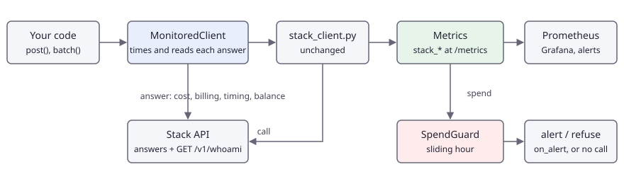

<!-- en-sha: f5099dbf895b -->
# 监控线上集成的成本与时延

[English](README.md) | 简体中文

用一个监控层包住客户端文件，把每次应答里的计费和耗时变成 Prometheus 指标（按模型和单位的 credits、按结果分类的调用数、编码缓存命中及省下的费用、排队和处理耗时、余额和每日额度），并在预算花完之前触发花费守卫。除了可选的、免费的 `GET /v1/whoami`，不需要向 API 多要任何东西。

## 问题 <!-- #problem -->

一个上线当天正常的集成，到了线上也可能在没有任何报错的情况下出问题：某个循环反复发送同一张图，提示词从每次 1 个涨到 10 个，批处理任务的规模翻倍，或者别人都在用的时候某个模型的排队时间悄悄变长。API 在每次应答里已经给了你需要的一切，但只针对那一次调用。你真正想要的是随时间变化的几个数字，以及数字异常时有人收到通知：

- 每小时多少 credits，按模型、按单位（`image`、`prompt`、`encode_image` ……）拆开，其中有多少是真正从余额扣掉的，有多少被每日包含额度覆盖；
- SAM 调用有多少次复用了已经编码过的图片（缓存命中时免收编码费），省下了多少；
- 调用在队列里等了多久、处理了多久，按服务器的测量；
- 账户还剩多少，余额快没了就报警；最近一小时的花费不正常时，拒绝继续发调用。

本例是这个监控层的 Python 版：一个文件 `monitoring.py`，复制到 `stack_client.py` 旁边就能用。它不修改客户端文件，而是包住一个客户端对象，读取每次应答（`cost`、`billing`、`cache`、`timing`、`balance`、错误码），批处理则读取每个 `item` 事件。用 21 次调用的回放（`assets/workload.jsonl`）端到端跑一遍，并检查指标和客户端自己的账本是否一致。

## 管线 <!-- #pipeline -->

<!-- figure: assets/pipeline.svg -->


| 步骤 | 做什么 | 端点 |
|---|---|---|
| 包装 | `MonitoredClient(StackClient(), Monitor(guard=...))`：`post` 和 `batch` 被度量，其余一律转发 | 无 |
| 调用 | 被包住的客户端照常发送：重试、节流、幂等和额度上限都是客户端的事 | `POST /v1/ocr`、`/v1/segment` ……、`POST /v1/batch/*` |
| 读取 | 按 `billing.lines[]` 记 credits，读 `cost`、`cache`、`timing.queueMs` / `processingMs`、`balance`、所在池的额度；错误按 `code` 计数 | 无 |
| 守卫 | 把最近一小时的花费与上限比较；每次越线报警一次，或拒绝新调用 | 无 |
| 刷新 | `refresh_account()` 读取余额和今天的每日额度；放在定时器里调用，`refresh_every(client, 60)` 就是这样 | `GET /v1/whoami`（免费，不计量） |
| 暴露 | `monitor.serve(9108)` 提供 `GET /metrics`；Prometheus 抓取，Grafana 和告警规则读取 | 无 |

指标，全部以 `stack_` 开头：

| 指标 | 标签 | 来源 |
|---|---|---|
| `stack_credits_total` | `model`、`unit`、`charged` | `billing.lines[]` 的每一行；`charged="false"` 是被每日包含额度覆盖的工作的标价 |
| `stack_calls_total` | `model`、`status`、`code` | `status` 为 `ok`、`replayed`、`error`、`expired` 或 `refused`（没有发出：额度上限或守卫）；`code` 是 API 错误码，`ok` 时为 `none` |
| `stack_cache_hits_total`、`stack_cache_misses_total` | `model` | SAM 应答的 `cache` |
| `stack_cache_saved_credits_total` | `model` | `waived: true` 的行的标价 |
| `stack_latency_ms`（直方图） | `model`、`phase` | `queue` 和 `processing` 来自 `timing`；`client_total` 是本进程在调用外围测到的时间，供你自己的看板使用 |
| `stack_balance_credits`、`stack_balance_updated_timestamp_seconds` | | 最近一次应答或 `whoami` 刷新的 `balance`，以及更新时刻 |
| `stack_daily_allowance_used`、`stack_daily_allowance_limit` | `pool` | 应答的 `billing.allowance` 和 `whoami` |
| `stack_spend_window_credits`、`stack_spend_guard_tripped` | | 守卫的窗口花费，以及是否越线 |

## 运行 <!-- #run -->

```bash
export FOLDBUN_API_KEY="fbs_..."          # 已充值的账户：sam-lite 需要
export FOLDBUN_MAX_CREDITS=2.75           # 客户端会拒绝可能超过它的调用
cd use-cases/08-cost-and-latency-monitoring/python
uv run main.py --out out --hold 30        # 21 次调用；运行期间和结束后 30 秒在 :9108 提供 /metrics
curl -s localhost:9108/metrics | grep '^stack_'                          # 在第二个终端里
uv run main.py --out out --guard-mode reject --guard-max 0.2            # 最近一小时超过 0.2 credits 后，守卫拒绝调用
uv run python ../evaluate.py --result out/result.json --overhead        # 核对账目，打印监控层的开销
```

参数：`--manifest`、`--out`、`--concurrency`（默认 1：一次一个调用，触发守卫的是第几个调用就是确定的）、`--limit`、`--resume`（接受但无作用：回放总是重新开始）、`--metrics-port`（默认 9108，0 表示不提供）、`--hold`、`--guard-max`（每小时 credits，默认 0.2）、`--guard-mode`（`alert` 或 `reject`）、`--guard-basis`（`charged` 或 `list`）。输出：`result.json`（格式见 `contract/result.schema.json`：每次调用一项，最后一项 `summary` 是监控层统计的内容）和 `metrics.prom`（运行结束时的文本格式指标）。

没有密钥时，可以对 API 的本地假服务跑同一个回放（见 `CONTRIBUTING.md`）；`uv run python -m harness check --uc 08` 就是这样做的。

新账户跑不了：`sam-lite` 和 `sam3` 会返回 `403 model_locked`，回放以退出码 3 结束。

要接进自己的服务，复制 `monitoring.py`，这样用：

```python
from stack_client import StackClient
from monitoring import Monitor, MonitoredClient, SpendGuard

guard = SpendGuard(max_per_hour=50, mode="alert", on_alert=notify)   # notify(info) 拿到调用序号、花费和上限
monitor = Monitor(guard=guard)
client = MonitoredClient(StackClient(), monitor)                     # 用在原来用 StackClient 的地方
monitor.serve(9108)                                                  # 或在自己的 Web 应用里返回 monitor.exposition()
monitor.refresh_every(client, 60)                                    # 余额和额度，每分钟刷新
```

这些指标对应的告警规则和 Grafana 看板在 `assets/alerts.rules.yml` 和 `assets/grafana-dashboard.json`（导入看板，选你的 Prometheus 数据源）。`assets/metrics.sample.prom` 是对本地假 API 回放一次得到的指标输出。

## 代码 <!-- #code -->

包装器。`post` 和 `batch` 被度量；其余属性（`upload`、`models`、`get`、`calls`、`summary`）都是被包住的客户端的。

<!-- code: wrapper -->
<details><summary>Python (python/monitoring.py)</summary>

```python
class MonitoredClient:
    """Wraps a StackClient. `post` and `batch` are measured; every other attribute (`upload`, `models`, `get`, `calls`,
    `summary`, `ledger`, ...) is the wrapped client's."""

    def __init__(self, client, monitor):
        self._client, self.monitor = client, monitor

    def __getattr__(self, name):
        return getattr(self._client, name)

    @staticmethod
    def _model(path, body):
        return body.get("model") or sc.DEFAULT_MODEL.get(path) or "unknown"

    def _replayed(self, tag):
        """Whether the client's ledger says the answer of this call was a replay of a stored one."""
        ledger = getattr(self._client, "ledger", None) or []
        for t, row in reversed(ledger[-32:]):
            if t == tag:
                return bool(row.get("replayed"))
        return False

    def post(self, path, body, idempotency_key=None, *, tag=None, **kwargs):
        model = self._model(path, body)
        tag = tag or self.monitor.next_tag()
        try:
            if self.monitor.guard:
                self.monitor.guard.check()
        except SpendGuardTripped as err:
            self.monitor.failure(model, err)
            raise
        t0 = self.monitor.clock()
        try:
            result = self._client.post(path, body, idempotency_key, tag=tag, **kwargs)
        except Exception as err:  # a StackError, or anything unexpected: counted, then raised unchanged
            self.monitor.failure(model, err, client_ms=(self.monitor.clock() - t0) * 1000)
            raise
        self.monitor.observe(model, result, replayed=self._replayed(tag), client_ms=(self.monitor.clock() - t0) * 1000)
        return result

    def batch(self, endpoint, body, idempotency_key=None, *, tag=None):
        """Like StackClient.batch (yields (event, data)); every `item` event is counted with its own cost and timing."""
        model = self._model(f"/v1/{endpoint}", body)
        if self.monitor.guard:
            self.monitor.guard.check()
        try:
            for event, data in self._client.batch(endpoint, body, idempotency_key, tag=tag):
                if event == "item":
                    status = data.get("status")
                    if status == "ok":
                        self.monitor.observe(model, data["result"], replayed=bool(data.get("replayed")))
                    else:
                        error = data.get("error") or {}
                        self.monitor.failure(
                            model, sc.StackError(0, error.get("code") or status, error.get("message", "")), status="expired" if status == "expired" else "error"
                        )
                yield event, data
        except Exception as err:  # the stream itself failed (cut, timed out, refused)
            self.monitor.failure(model, err)
            raise

    def whoami(self):
        return self.monitor.refresh_account(self._client)
```

</details>
<!-- /code -->

从一次应答里读什么，变成哪些指标：

<!-- code: observe -->
<details><summary>Python (python/monitoring.py)</summary>

```python
def observe(self, model, result, *, replayed=False, client_ms=None):
    """One successful call (or `ok` batch item): `result` is the answer body."""
    model = result.get("model") or model
    self.calls.labels(model, "replayed" if replayed else "ok", "none").inc()
    if client_ms is not None:
        self.latency.labels(model, "client_total").observe(client_ms)
    billing = result.get("billing") or {}
    cost = result.get("cost", 0)
    if not replayed:  # a replay returns the stored answer of a call that was already counted
        timing = result.get("timing") or {}
        for phase, key in (("queue", "queueMs"), ("processing", "processingMs")):
            if key in timing:
                self.latency.labels(model, phase).observe(timing[key])
        charged = "true" if billing.get("charged", cost > 0) else "false"
        for line in billing.get("lines") or [{"unit": "unknown", "amount": cost, "waived": False}]:
            if line.get("waived"):
                self.cache_saved.labels(model).inc(round(line["unitPrice"] * line["quantity"], 6))
            elif line["amount"]:
                self.credits.labels(model, line["unit"], charged).inc(line["amount"])
        if result.get("cache") == "hit":
            self.cache_hits.labels(model).inc()
        elif result.get("cache") == "miss":
            self.cache_misses.labels(model).inc()
        if "balance" in result:
            self._set_balance(result["balance"])
        if billing.get("pool") and billing.get("allowance"):
            self.allow_used.labels(billing["pool"]).set(billing["allowance"]["used"])
            self.allow_limit.labels(billing["pool"]).set(billing["allowance"]["limit"])
    by_list = self.guard is not None and self.guard.basis == "list"
    self._guard_record(0 if replayed else billing.get("total", cost) if by_list else cost)

def failure(self, model, error, *, status="error", client_ms=None):
    """One failed call: `error` is a StackError (or anything with `.code`). Local refusals count as "refused"."""
    code = getattr(error, "code", None) or type(error).__name__
    if getattr(error, "status", None) == 0 and code in ("budget_exceeded", "spend_guard_tripped"):
        status = "refused"
    self.calls.labels(model, status, code).inc()
    if client_ms is not None:
        self.latency.labels(model, "client_total").observe(client_ms)
    self._guard_record(0)

def _set_balance(self, value):
    self.balance.set(value)
    self.balance_at.set(self.wall())

def _guard_record(self, amount):
    if self.guard:
        self.guard.record(amount)
        self.window_spend.set(self.guard.spent())
        self.guard_tripped.set(1 if self.guard.tripped else 0)
```

</details>
<!-- /code -->

花费守卫：滑动窗口，用整数微 credits 累加，求和不会漂移，时钟可以在测试里替换。`alert` 每次越线回调一次，花费回落到上限以下后重新待命；`reject` 在越线期间拒绝新调用。

<!-- code: guard -->
<details><summary>Python (python/monitoring.py)</summary>

```python
class SpendGuard:
    """Sliding-window spend rate. `max_per_hour` credits over the last `window_s` seconds (default one hour).

    mode "alert":  `on_alert(info)` runs once each time the spend crosses the limit; calls are not stopped.
    mode "reject": `check()` raises SpendGuardTripped while the spend of the window is over the limit.
    basis "charged" counts what the account is debited (calls inside a daily allowance count 0); "list" counts the list price.
    Pure logic: pass `clock` (a function returning seconds) to test it without waiting."""

    def __init__(self, max_per_hour, *, mode="alert", basis="charged", on_alert=None, window_s=3600.0, clock=time.monotonic):
        if mode not in ("alert", "reject") or basis not in ("charged", "list"):
            raise ValueError('mode is "alert" or "reject"; basis is "charged" or "list"')
        self.max_per_hour, self.mode, self.basis, self.on_alert = max_per_hour, mode, basis, on_alert
        self.window_s, self.clock = window_s, clock
        self.records, self.alerts, self.tripped = 0, 0, False  # calls recorded, alerts raised, over the limit right now
        self._events, self._micro, self._lock = collections.deque(), 0, threading.Lock()

    def _expire(self, now):
        while self._events and self._events[0][0] <= now - self.window_s:
            self._micro -= self._events.popleft()[1]

    def spent(self):
        """Credits spent inside the window now."""
        with self._lock:
            self._expire(self.clock())
            return self._micro / 1e6

    def check(self):
        """Call before sending: in mode "reject", raises SpendGuardTripped while the window's spend is over the limit."""
        if self.mode != "reject":
            return
        with self._lock:
            self._expire(self.clock())
            over, spent = self._micro > self.max_per_hour * 1e6, self._micro / 1e6
        if over:
            raise SpendGuardTripped(
                f"call refused: {spent:g} credits in the last {self.window_s / 60:g} minutes pass the limit of {self.max_per_hour:g} credits"
            )

    def record(self, amount):
        """Add the spend of one finished call (0 is fine; it still counts as a call). Returns True when this call tripped the guard."""
        with self._lock:
            now = self.clock()
            self._expire(now)
            micro = round(amount * 1e6)
            self._events.append((now, micro))
            self._micro += micro
            self.records += 1
            over = self._micro > self.max_per_hour * 1e6
            fired = over and not self.tripped
            self.tripped = over
            info = {
                "call": self.records,
                "spent": self._micro / 1e6,
                "max_per_hour": self.max_per_hour,
                "window_s": self.window_s,
                "mode": self.mode,
                "basis": self.basis,
            }
            if fired:
                self.alerts += 1
        if fired and self.on_alert:
            self.on_alert(info)
        return fired
```

</details>
<!-- /code -->

用 `GET /v1/whoami` 取余额和每日额度，按需或定时：

<!-- code: account -->
<details><summary>Python (python/monitoring.py)</summary>

```python
def refresh_account(self, client):
    """GET /v1/whoami (free, not metered, no rate-limit token): balance and today's daily allowances."""
    info = client.get("/v1/whoami")
    self._set_balance(info["balance"])
    for a in info.get("dailyAllowances", []):
        self.allow_used.labels(a["pool"]).set(a["used"])
        self.allow_limit.labels(a["pool"]).set(a["limit"])
    return info

def refresh_every(self, client, seconds):
    """Refresh in a background thread; `.set()` the returned event to stop it. Errors are swallowed: the gauges just go stale."""
    stop = threading.Event()

    def loop():
        while not stop.wait(seconds):
            try:
                self.refresh_account(client)
            except Exception:  # noqa: BLE001
                pass

    threading.Thread(target=loop, daemon=True, name="stack-whoami").start()
    return stop
```

</details>
<!-- /code -->

回放把监控层接在客户端外面，单个调用失败时继续跑（失败是数据，不是崩溃）；只有模型被锁或额度上限才会让它停下：

<!-- code: wire -->
<details><summary>Python (python/main.py)</summary>

```python
try:
    client = sc.StackClient(max_concurrency=args.concurrency)  # FOLDBUN_API_KEY, FOLDBUN_API_BASE, FOLDBUN_MAX_CREDITS
    client.models()  # free: checks the key
except sc.MissingApiKey as err:
    print(err.message, file=sys.stderr)
    return EXIT_NO_KEY
alerts = []
guard = SpendGuard(
    args.guard_max, mode=args.guard_mode, basis=args.guard_basis, on_alert=lambda info: (alerts.append(info), print(f"ALERT: {info}", file=sys.stderr))
)
monitor = Monitor(guard=guard)
mc = MonitoredClient(client, monitor)
if args.metrics_port:
    try:
        monitor.serve(args.metrics_port)
        print(f"metrics: http://localhost:{args.metrics_port}/metrics")
    except OSError as err:
        print(f"metrics not served: {err}", file=sys.stderr)
```

</details>
<!-- /code -->

<!-- code: replay -->
<details><summary>Python (python/main.py)</summary>

```python
def run_call(mc, entry, handles):
    """One workload line -> one result item. Failures are data (status `error`); only a locked model or the credit cap stop the run."""
    body = {"model": entry["model"], "image": sc.image_handle(handles[entry["image"]]), **entry["request"]}
    try:
        result = mc.post(entry["endpoint"], body, tag=entry["id"])
    except sc.StackError as err:
        print(f"  {entry['id']}: {err.status} {err.code}: {err.message}" + (f" (request {err.request_id})" if err.request_id else ""), file=sys.stderr)
        if err.code in ("model_locked", "budget_exceeded"):
            raise
        return {"id": entry["id"], "status": "error", "calls": [], "output": None, "error": {"status": err.status, "code": err.code, "message": err.message}}
    billing = result.get("billing") or {}
    waived = sum(ln["unitPrice"] * ln["quantity"] for ln in billing.get("lines", []) if ln.get("waived"))
    output = {
        "kind": "call",
        "model": entry["model"],
        "endpoint": entry["endpoint"],
        "cache": result.get("cache"),
        "listCredits": billing.get("total", result.get("cost", 0)),
        "chargedCredits": result.get("cost", 0),
        "waivedCredits": round(waived, 6),
    }
    return {"id": entry["id"], "status": "ok", "calls": mc.calls(entry["id"]), "output": output}
```

</details>
<!-- /code -->

## 结果 <!-- #results -->

工作负载是 `assets/workload.jsonl`：对 Playground 设置页截图（用例 00）做 6 次 `ppocr-v6` 读取，对一张照片做 10 次 `sam-lite` 框调用，对另一张照片做 5 次 `sam3` 文字调用（两张照片都来自用例 01 的 smoke 集），穿插排列，使守卫的每个阶段都能看到。标价逐次算出来：

| 调用数 | 模型 | 每次标价 | 合计 |
|---|---|---|---|
| 6 | `ppocr-v6`（image） | 0.25 | 1.50 |
| 10，同一张图 | `sam-lite`（编码 0.20 一次，之后 box 0.01） | 第一次 0.21，之后 0.01 | 0.30 |
| 5，同一张图 | `sam3`（编码 0.50 一次，之后 prompt 0.05） | 第一次 0.55，之后 0.05 | 0.75 |
| 21 | | | 2.55 |

在一个已充值、且每日额度覆盖 `ppocr-v6`（公共池）和 `sam-lite`（免费池）的账户上，只有 `sam3` 会被扣费：约 0.75 credits。回放需要的额度上限是 `FOLDBUN_MAX_CREDITS=2.75`：客户端按最坏情况计一次调用（编码费总是算进去），额度内的调用也按标价计入，所以上限要容得下已花的 2.55 加上下一次调用的最坏情况；工作负载的顺序为此把 SAM 调用排得靠前，测试会检查这一点。若把回放放大到 40 次 OCR，仅这一项按标价就是 10 credits。

有了编码缓存，15 次 SAM 调用中有 13 次复用了已有编码（`sam-lite` 9 次，`sam3` 4 次），省下 9 x 0.20 + 4 x 0.50 = 3.80 credits 的编码费，否则这笔费用会出现在 `stack_credits_total` 里。花费守卫设为每小时 0.2 credits（按实扣计），在第一次 `sam3` 调用时触发（第 8 次调用：光编码费就是 0.50）；如果这张图的编码在上次运行后还留在缓存里，则在第五次触发。账目一致的含义是：指标里的 `credits.list` 和 `credits.charged` 等于客户端账本的 `ledger.listTotal` 和 `ledger.chargedTotal`；`evaluate.py` 检查这一点以及上面三个条件。

监控层每次调用约 20 微秒，在 6 vCPU 的云主机上由 `evaluate.py --overhead` 测得：对一个 `post` 立即返回预制应答的客户端，守卫开启，应答是带三行计费的 SAM 应答，取 5 轮、每轮 3000 次调用中最快的一轮；测试断言它保持在 500 微秒以下。这只是对一次应答做的 Python 记账，相比一次调用的几十到几千毫秒微不足道。

真实运行的实测数据，包括应答里服务端的耗时，以及 `evaluate.py` 打印的数字：

<!-- metrics: expected/full-summary.json -->
尚未实测。
<!-- /metrics -->

在记录第一次线上运行之前，`expected/offline.json` 保存的是对离线假 API 的回放。它展示监控层怎么工作，不代表模型的表现：假服务的耗时和缓存状态都是脚本设定的。

## 成本 <!-- #cost -->

<!-- cost -->
尚未实测。
<!-- /cost -->

一次 smoke 运行的标价是 2.55 credits；实际扣多少取决于账户（见「结果」）。Full 与它相同。

## 改成自己的 <!-- #adapt -->

- **自己的工作负载**：替换 `assets/workload.jsonl`（每行一个 JSON 对象：`id`、`endpoint`、`model`、`image`（manifest 里的 id）、`request`（去掉 `image` 和 `model` 的请求体）），并把图片列在 `assets/manifest.json` 里。
- **自己的服务**：只需要 `monitoring.py` 和 `stack_client.py`。每个进程一个 `Monitor`，在原来用客户端的地方用一个 `MonitoredClient`，提供 `/metrics`，或在自己的端点里返回 `monitor.exposition()`。多个进程：每个进程是一个独立的 Prometheus 抓取目标，在查询里求和，看板就是这样做的。
- **上限与模式**：`SpendGuard(max_per_hour, mode="reject")` 用 `SpendGuardTripped`（错误码 `spend_guard_tripped`）拒绝调用；在能降级的地方捕获它。`basis="list"` 按标价计，包含被额度覆盖的调用。上限按你平时的每小时花费再留一些余量来定。
- **标签**：`model` 只有七个取值，`unit` 也只有几个，序列数很少。不要把图片 id、调用 id 或请求 id 当标签。
- **其他语言**：任何能读取应答里 `billing`、`cost`、`cache`、`timing`、`balance` 的客户端都能导出同名指标，看板和规则可以直接沿用。

## 局限与不适用的情况 <!-- #limits -->

- **这里不提供端到端时延。** 客户端看到的时延取决于它到 API 的网络路径，所以本用例的测量不包含它；排队和处理时间是服务端自己的 `timing`。监控层导出 `client_total`（本进程在调用外围测到的时间），方便你监视自己的环境，但本页不公布这样的数字。
- **余额只和最近一次应答或刷新一样新。** `stack_balance_credits` 只在调用结束或读取 `whoami` 时变化；一个不发调用的进程显示的是旧数字（`stack_balance_updated_timestamp_seconds` 告诉你旧了多久）。同一账户的其他密钥也会改变余额，只有刷新才能看到。
- **不是账单。** 指标是你的进程对它收到的应答的看法，权威是账户控制台：其他进程或密钥发的调用不会出现，在回程中丢失的应答已被扣费却不会被计入。指标用来发现问题，对账以控制台为准。
- **批处理（SSE）按项统计。** 每个 `item` 事件里的成本和耗时按一次调用读取；批内的单项没有客户端耗时，所以不记录 `client_total`。在 summary 事件之前断开的流计为一次失败调用，断开前已收到的项仍保留在统计里。
- **重放通过客户端的账本识别**：账本把重试调用得到的存档应答标为 `replayed`；它们计为 `status="replayed"`，不增加 credits。多线程又没有 `tag` 时，这个查找在极少数情况下可能把标记算到相邻的调用上。
- **守卫只在单个进程内。** 滑动窗口在一个进程的内存里，重启即丢失；多个进程时，用 Prometheus 对总和告警（`assets/alerts.rules.yml`），守卫只作为本地的保险。
- **缓存计数跟随 API 的缓存**，而缓存不在 API 的承诺之内：回放时图片已被编码过，省下的比上面的数字多；已被逐出，则省得少。

## 数据 <!-- #data -->

工作负载用的图片都已在本仓库里：用例 00 的设置页截图（`../00-quickstart/assets/smoke/settings.webp`，CC0，来自 Playground 样例）和用例 01 smoke 集里的两张照片（`../../datasets/smoke/01-dataset-prelabelling/images/`，Open Images，CC BY 2.0）。它们的 sha256 在 `assets/manifest.json` 里；作者和许可证在这些目录的 `ATTRIBUTION.csv` 和 `ATTRIBUTION.md` 里。没有新增数据。
